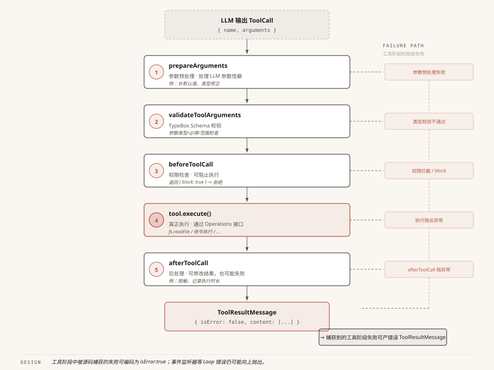
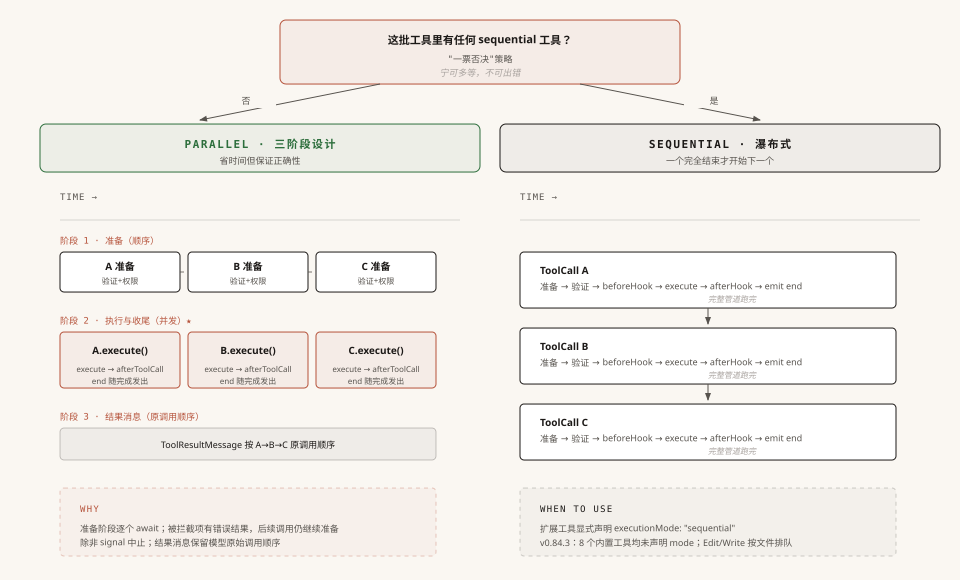

# 第5章：工具系统 —— Agent 的手脚是怎么被管住的

> 源码基准：本地 `pi-main` 快照，核心包版本 `v0.84.3`，核对日期 `2026-10-12`。下文路径均相对源码根目录。

第 3 章讲 Agent Loop 时，我们追踪了"模型决定调用 read 工具"到"工具结果回到模型面前"这段旅程。但当时把它当黑盒跳过了——只说了"Loop 执行工具"，没说具体怎么执行的。

这一章就来打开这个黑盒。

当模型的回复里出现了这样一条指令：

```json
{ "type": "toolCall", "id": "call_abc123", "name": "read", "arguments": { "path": "src/main.ts" } }
```

从这条指令到文件内容回到模型面前，中间经历了什么？

你的第一反应可能是：找到 read 工具，读文件，把内容塞进消息，完事。但现实中没这么简单——模型可能传了错误类型的参数（`path: 12345` 而不是 `"src/main.ts"`），模型可能要求执行危险命令（`rm -rf /`），工具执行时可能抛异常（文件不存在）。

Pi 的工具调用路径可分成**五步**：参数预处理 → Schema 验证 → 前置钩子 → 工具执行 → 后置钩子。源码会把这几处受控失败转换成错误工具结果；这不是对 Agent Loop 中所有异常都永不抛出的承诺。

但在讲管道之前，得先搞清楚一个更基础的问题：**工具到底是怎么定义的？** 为什么 Pi 要设计三层类型来描述"一个工具"？

---

## 一、三层类型：为什么"一个工具"要分三层来定义？

### 第一层：Tool——一张"名片"

打开 `packages/ai/src/types.ts`，你会看到工具的最底层定义：

```python
# ============================================================
# 【Python 改写】对应本节 TypeScript 节选
# 原文 TS:
#   // Source: packages/ai/src/types.ts — Tool
#   export interface Tool<TParameters extends TSchema = TSchema> {
#       name: string;            // 工具名，如 "read"、"bash"
#       description: string;     // 给 LLM 看的工具描述
#       parameters: TParameters; // 参数的 JSON Schema（用 TypeBox 定义）
#       constrainedSampling?: false | ConstrainedSamplingConfig; // 可选的 provider 约束采样配置
#   }
# ============================================================

# 概念对照：TS 接口字段用 Python 类型注解示意；这不是 Pi 的 Python SDK。

class Tool:
    name: str
    description: str
    parameters: object
    constrained_sampling: object | bool | None = None
```

三个必填字段和一个可选采样配置。工具就是一个有名字、有描述、有参数 Schema 的东西。

这个接口住在 `pi-ai` 层——纯模型适配层。它唯一关心的事情是：**怎么把工具的信息告诉模型。** `name` 和 `description` 会出现在发给模型的 API 请求里，`parameters` 告诉模型"你可以传哪些参数"。

在这个层面，工具只是**一张名片**。能描述自己，但不能执行任何操作。

### 第二层：AgentTool——加上了"执行能力"

Agent Loop 要执行工具调用，光有名片不够。它需要知道**怎么执行**这个工具、这个工具**能不能并行执行**、参数格式要不要**预处理**。

于是 `pi-agent-core` 层在 Tool 基础上扩展了 `AgentTool`：

```python
# ============================================================
# 【Python 改写】对应本节 TypeScript 节选
# 原文 TS:
#   // Source: packages/agent/src/types.ts — AgentTool
#   export interface AgentTool<TParameters extends TSchema = TSchema, TDetails = any>
#       extends Tool<TParameters>          // 继承 Tool 的描述与参数等字段
#   {
#       label: string;                     // 给人看的标签（不同于给 LLM 的 description）
#       prepareArguments?: (args: unknown) => Static<TParameters>;  // 兼容性垫片
#       execute: (                         // 执行函数
#           toolCallId: string,
#           params: Static<TParameters>,
#           signal?: AbortSignal,
#           onUpdate?: AgentToolUpdateCallback<TDetails>,
#       ) => Promise<AgentToolResult<TDetails>>;
#       executionMode?: "sequential" | "parallel";  // 执行模式
#   }
# ============================================================

# 概念对照：类继承表示扩展基础描述字段；execute 是必需异步操作，后两个参数可选。

class AgentTool(Tool):
    label: str
    prepare_arguments: object | None = None
    execution_mode: str | None = None

    async def execute(self, tool_call_id, params, signal=None, on_update=None):
        raise NotImplementedError
```

从 Tool 到 AgentTool，新增了 4 个字段。每个都有明确用途：

- **`label`**：模型看到的是 `name`（"read"），UI 看到的是 `label`（"读取文件"）
- **`prepareArguments`**：兼容层，处理不同模型输出的参数怪癖（后面详讲）
- **`execute`**：真正干活的函数——模型说"读文件"，这个函数去读
- **`executionMode`**：标记这个工具能否和其他工具并行执行

### 第三层：ToolDefinition——产品层再加东西

到了 `pi-coding-agent` 层（产品运行层），工具还需要更多能力：自定义渲染（read 工具在终端里怎么显示？edit 工具怎么展示 diff？）、提示词注入（有些工具需要在系统提示词里加一段使用指南）。

于是出现了第三层 `ToolDefinition`。它是产品层单独定义的接口，**没有继承 `AgentTool`**；两者共享名称、标签、描述、参数和执行模式等字段，但 `ToolDefinition.execute` 还要求第五个参数——`ctx: ExtensionContext`：

下面是接口字段的节选，只展示与运行时适配相关的部分；类型别名和渲染上下文定义省略。

```python
# ============================================================
# 【Python 改写】对应本节 TypeScript 节选
# 原文 TS:
#   export interface ToolDefinition<TParams extends TSchema = TSchema, TDetails = unknown, TState = any> {
#       name: string;
#       label: string;
#       description: string;
#       parameters: TParams;
#       prepareArguments?: (args: unknown) => Static<TParams>;
#       executionMode?: ToolExecutionMode;
#       execute(
#           toolCallId: string,
#           params: Static<TParams>,
#           signal: AbortSignal | undefined,
#           onUpdate: AgentToolUpdateCallback<TDetails> | undefined,
#           ctx: ExtensionContext,
#       ): Promise<AgentToolResult<TDetails>>;
#       renderCall?: (args: Static<TParams>, theme: Theme, context: ToolRenderContext<TState, Static<TParams>>) => Component;
#       renderResult?: (
#           result: AgentToolResult<TDetails>,
#           options: ToolRenderResultOptions,
#           theme: Theme,
#           context: ToolRenderContext<TState, Static<TParams>>,
#       ) => Component;
#   }
# ============================================================

# 概念对照：独立产品接口；可选回调默认为 None，execute 比内核接口多一个 ctx。
from typing import Any, Awaitable, Callable, Literal

class ToolDefinition:
    name: str
    label: str
    description: str
    parameters: Any
    prepare_arguments: Callable[[Any], Any] | None = None
    execution_mode: Literal["sequential", "parallel"] | None = None
    render_call: Callable[[Any, Any, Any], Any] | None = None
    render_result: Callable[[Any, Any, Any, Any], Any] | None = None

    async def execute(self, tool_call_id, params, signal, on_update, ctx):
        raise NotImplementedError
```

它还定义了 `promptSnippet`、`promptGuidelines`、`renderCall`、`renderResult` 等产品层能力。源码位置：`packages/coding-agent/src/core/extensions/types.ts` — `ToolDefinition`。

### 桥接两层：wrapToolDefinition

Agent Loop 只认识 `AgentTool`，但产品层的工具都是 `ToolDefinition`。谁来把 ToolDefinition 变成 AgentTool？

答案是包装器函数 `wrapToolDefinition`。下面是它的执行适配节选；其他复制的字段和泛型细节省略：

```python
# ============================================================
# 【Python 改写】对应本节 TypeScript 节选
# 原文 TS:
#   export function wrapToolDefinition<TDetails = unknown>(
#       definition: ToolDefinition<any, TDetails>,
#       ctxFactory?: () => ExtensionContext,
#   ): AgentTool<any, TDetails> {
#       return {
#           name: definition.name,
#           label: definition.label,
#           description: definition.description,
#           parameters: definition.parameters,
#           constrainedSampling: definition.constrainedSampling,
#           prepareArguments: definition.prepareArguments,
#           executionMode: definition.executionMode,
#           execute: (toolCallId, params, signal, onUpdate, ctx?: ExtensionContext) =>
#               definition.execute(toolCallId, params, signal, onUpdate, ctx ?? (ctxFactory?.() as ExtensionContext)),
#       };
#   }
# ============================================================

# 概念对照：包装器复制共享字段，并把四参数 AgentTool 调用适配为含 ctx 的产品层执行函数。

def wrap_tool_definition(definition, ctx_factory=None):
    async def execute(tool_call_id, params, signal=None, on_update=None, ctx=None):
        if ctx is None and ctx_factory is not None:
            ctx = ctx_factory()
        return await definition.execute(tool_call_id, params, signal, on_update, ctx)

    return {
        "name": definition.name,
        "label": definition.label,
        "description": definition.description,
        "parameters": definition.parameters,
        "constrained_sampling": getattr(definition, "constrained_sampling", None),
        "prepare_arguments": definition.prepare_arguments,
        "execution_mode": definition.execution_mode,
        "execute": execute,
    }
```

注意最后一行。Agent Loop 按 `AgentTool.execute` 的四参数接口调用工具；包装器在产品边界把上下文作为第五个参数传给 `ToolDefinition.execute`。当调用方没有直接传入上下文、且提供了 `ctxFactory` 时，包装器用闭包工厂生成上下文。**Agent Loop 不需要依赖 ExtensionContext。**源码位置：`packages/coding-agent/src/core/tools/tool-definition-wrapper.ts` — `wrapToolDefinition`。

### 为什么非要分三层？

把所有字段塞进一个 `Tool` 接口，加几个可选字段不就行了？

不行。原因是**每层有独立的依赖范围**。`pi-ai` 层的 `Tool` 接口只依赖 TypeBox 的 `TSchema`。如果在这个接口里加了 `renderCall`（返回终端 UI 组件），`pi-ai` 就得依赖终端 UI 渲染库。但 `pi-ai` 是纯模型适配层——它的工作只是"把工具信息格式化成 API 请求"，不应该知道终端 UI 长什么样。

三层递进的本质是：**每一层只加自己这个层级需要的能力，不越界。** `Tool` 管"我能描述自己"，`AgentTool` 管"我能被执行"，`ToolDefinition` 管"我能被展示和扩展"。

---

## 二、五步管道：工具调用不是"调个函数就完了"

类型定义搞清楚了，现在看工具调用的实际执行过程。



**配图说明**：从 ToolCall 到 ToolResultMessage 的五步垂直管道。图中只覆盖工具准备、执行和收尾阶段捕获的失败；它不表示 Agent Loop 的所有异常都被吞掉。

### 为什么不能直接调函数？

最简单的处理方式：找到 read 工具 → 读文件 → 把内容塞进 ToolResultMessage → 完事。一行函数调用，很直觉。

但模型的输出并不总是规规矩矩的：

- **参数格式不对**：Edit 工具期望 `edits` 是一个数组，但某些模型会把数组序列化成字符串 `"[{...}]"` 传过来
- **参数类型错误**：Read 工具的 `path` 参数是 string，但模型可能传个数字 `12345`
- **危险操作**：模型要求执行 `rm -rf /`，你的 Agent 真的去执行吗？

这些问题意味着"直接调函数"是不够的。你需要在执行前加几道关卡。

### Pi 的答案：五步管道

```
LLM 输出 ToolCall
    │
    ▼
┌──────────────────────────────────────────────────┐
│ 第 1 步：prepareArguments（参数预处理）           │
│   处理 LLM 的参数怪癖                            │
│   如：把字符串化的数组解析回真正的数组             │
├──────────────────────────────────────────────────┤
│ 第 2 步：validateToolArguments（Schema 验证）     │
│   用 TypeBox Schema 做运行时类型检查              │
│   如：path 是 string，不是 number                │
├──────────────────────────────────────────────────┤
│ 第 3 步：beforeToolCall（前置钩子）              │
│   产品层的权限拦截，可以阻止执行                   │
│   返回 { block: true, reason: "危险命令"}         │
├──────────────────────────────────────────────────┤
│ 第 4 步：tool.execute（实际执行）                 │
│   调用工具的 execute 函数                         │
│   支持 onUpdate 流式进度回调                      │
├──────────────────────────────────────────────────┤
│ 第 5 步：afterToolCall（后置钩子）               │
│   产品层的结果后处理，可以修改返回值               │
│   可以替换 content、details、isError              │
└──────────────────────────────────────────────────┘
    │
    ▼
ToolResultMessage
```

每一步都有明确的职责和退出机制。前 3 步是准备工作——任一步返回阻止结果或抛出受控错误，都不会调用工具。第 4 步才执行工具，第 5 步完成结果后处理。我们逐步展开。

### 第 1 步：prepareArguments——兼容性垫片

不同模型的 API 在序列化工具参数时有微妙的差异。`prepareArguments` 就是为这些差异准备的兼容层。

比如 Edit 工具期望 `edits` 是数组：

```python
# ============================================================
# 【Python 改写】对应本节 TypeScript 节选
# 原文 TS:
#   // 模型实际传来的（某些模型把 JSON 数组序列化成了字符串）
#   const modelArgs = { edits: "[{\"oldText\":\"hello\",\"newText\":\"world\"}]" };
#
#   // 经过 prepareArguments 处理后
#   const normalizedArgs = { edits: [{ oldText: "hello", newText: "world" }] };
# ============================================================

# 概念对照：模型参数中的 JSON 字符串被预处理为真正的列表。

model_args = {"edits": '[{"oldText":"hello","newText":"world"}]'}
normalized_args = {"edits": [{"oldText": "hello", "newText": "world"}]}
```

如果工具没定义 `prepareArguments`，参数直接透传。这一步的代码很简单——有就用，没有就跳过。

**为什么不在 Schema 验证里一起处理？** 因为它们关注的事情不同。`prepareArguments` 是"我知道某个模型会犯什么错"的兼容层——只处理特定模型的已知问题。`validateToolArguments` 是"不管谁调我都得验"的安全层——保证参数类型正确。一个是兼容性，一个是正确性，混在一起会让代码很难维护。

### 第 2 步：validateToolArguments——Schema 验证

经过预处理后，参数还要过一道 TypeBox 的运行时类型检查。比如 `path` 定义为 string，但模型传了 number：

```
Before：{ path: 12345 }
After： 验证失败 → 报错 → 不执行工具
```

验证错误会被 `prepareToolCall` 捕获，并生成错误工具结果。**工具永远不会收到未通过 Schema 验证的参数。**源码位置：`packages/agent/src/agent-loop.ts` — `prepareToolCall`。

### 第 3 步：beforeToolCall——前置钩子（可阻止执行）

参数验证通过后，在执行之前，产品层还有一次拦截机会。`beforeToolCall` 是一个回调函数，可以检查命令是否危险：

| 返回值 | 效果 |
|--------|------|
| `undefined` | 放行，继续执行工具 |
| `{ block: true, reason: "危险命令" }` | 阻止执行，生成错误 ToolResultMessage |

**注意**：即使工具被阻止，也会生成一条 `ToolResultMessage`，并标记 `isError: true`。模型会看到拒绝原因，再决定下一步。这里说的是这个工具调用分支的结果，不代表整个 Agent Loop 对任意异常都能继续运行。

### 第 4 步：tool.execute——实际执行

前 3 步都通过后，工具的 `execute` 函数被真正调用。回头看一下它的签名：

```python
# ============================================================
# 【Python 改写】对应本节 TypeScript 节选
# 原文 TS:
#   interface ExecuteSignatureExample {
#       execute: (
#           toolCallId: string,
#           params: unknown,
#           signal?: AbortSignal,
#           onUpdate?: AgentToolUpdateCallback,
#       ) => Promise<AgentToolResult>;
#   }
# ============================================================

# 概念对照：AgentTool.execute 有四个入参；Python 用 async def 和默认值表达异步及可选参数。

async def execute_signature_example(tool_call_id, params, signal=None, on_update=None):
    raise NotImplementedError
```

四个参数——`toolCallId` 是这次调用的 ID，`params` 是验证过的参数，`signal` 是用于取消的 AbortSignal（用户按 Ctrl+C 时触发）。第四个 `onUpdate` 是什么？

**它解决的是"长任务的进度感知"问题。** 假设 Bash 工具要跑一个 30 秒的命令——如果只有"开始执行"和"执行完成"两个时刻能向外界报告，用户在这 30 秒里只能盯着加载动画。`onUpdate` 让工具能**边执行边向外推消息**：Bash 工具把输出更新按 100ms 节流后推送。这些推送被包装成 `tool_execution_update` 事件，交给事件订阅者处理。

简单说：**没有 `onUpdate`，工具执行过程对事件订阅者不可见；有了它，工具可以报告中间状态。** 这是 Bash 等长任务实时汇报进度的机制。

但有个边角问题需要处理。工具的 `execute` 是异步函数，它 `return` 之后，内部可能还有没结束的异步操作——比如 Bash 工具的子进程在主命令返回后还在异步打印最后几行日志。如果这些延迟回调还往 `onUpdate` 推数据，就会污染一个**已经结束**的工具调用，让 UI 上下文错乱。Pi 用一个 `acceptingUpdates` 标志位解决：`execute` 一旦返回（或抛异常），立即把标志位关掉，之后所有 `onUpdate` 调用一律静默丢弃。这是工程上的防御性细节，不复杂，但必须要有。

`onUpdate` 推出的事件最终流向哪里？这个问题很重要——后续章节会展开。这里只需要记住：工具执行不是黑盒，进度可观察。

如果 `tool.execute()` 抛出异常怎么办？别担心，§四 会详细讲这是怎么处理的——剧透一句：异常会被翻译成一条 `isError: true` 的消息发给模型。

### 第 5 步：afterToolCall——后置钩子（可修改结果）

工具执行完毕后，产品层还有一次修改结果的机会。`afterToolCall` 可以做这些事情：

| 场景 | 做什么 | 怎么做 |
|------|--------|--------|
| 脱敏 | 把工具返回的敏感信息替换掉 | 返回 `{ content: [{type:"text", text:"[已脱敏]"}] }` |
| 审计 | 记录工具调用的详细信息 | 读取 result，写日志，返回 `undefined`（不改结果） |
| 修错 | 把工具的错误结果修正为正常结果 | 返回 `{ isError: false, content: [...] }` |
| 停止自动续轮 | 给当前工具结果附上停止提示 | 返回 `{ terminate: true }`；只有批次中每个最终结果都带此标记，才会取消由本批工具调用触发的自动续轮。后续 steering/follow-up 队列仍可能开启新 Turn |

合并语义是字段级覆盖——提供了就替换，没提供就保留原值。`afterToolCall` 在并行分支中会随各工具执行结果并发调用。

### 管道的终点：ToolResultMessage

五步走完，不管中间出了什么状况，最终产物都是一条 `ToolResultMessage`：

```python
# ============================================================
# 【Python 改写】对应本节 TypeScript 节选
# 原文 TS:
#   {
#       role: "toolResult",
#       toolCallId: "call_abc123",      // 关联到原始 ToolCall
#       toolName: "read",
#       content: [{ type: "text", text: "1│ import { Agent }..." }],
#       details: { language: "typescript" },  // 给 UI 的元数据
#       isError: false,                  // 是否为错误结果
#       timestamp: 1700000000000,
#   }
# ============================================================

# 概念对照：消息对象用字典表示；details 是宿主/UI 元数据，工具结果仍通过调用 ID 关联。

tool_result_message = {
    "role": "toolResult",
    "toolCallId": "call_abc123",
    "toolName": "read",
    "content": [{"type": "text", "text": "1│ import { Agent }..."}],
    "details": {"language": "typescript"},
    "isError": False,
    "timestamp": 1700000000000,
}
```

这条消息会追加到 Agent 的内存对话状态，在下一轮模型请求中作为上下文的一部分。低层 `pi-agent-core` 的 `Agent` 不会自动持久化会话或执行上下文压缩；这些由宿主应用的会话与上下文管理层负责。

**工具管道中被源码捕获的失败会变成 `isError: true` 的 ToolResultMessage。** 模型看到这些工具错误消息后，可以根据上下文决定怎么处理。这个设计有什么价值？§四 会详细展开。

---

## 三、并行 vs 串行：一个批次的工具不是"一起跑就完了"



**配图说明**：顶部"一票否决"决策——只要有一个工具声明 sequential，整批串行。左侧绿色三阶段（顺序准备→并发执行与收尾→有序结果消息），右侧黑色瀑布式串行。底部说明逐个准备时的拦截结果，以及何时用串行。

### 模型经常一次调用多个工具

Agent Loop 的内层循环中，模型的一次回复可能包含多个 ToolCall：

```
assistantMessage.content = [
    { type: "text", text: "我来查一下文件" },
    { type: "toolCall", id: "call_1", name: "read", arguments: {path: "a.ts"} },
    { type: "toolCall", id: "call_2", name: "grep", arguments: {pattern: "TODO"} },
    { type: "toolCall", id: "call_3", name: "find", arguments: {pattern: "*.test.ts"} },
]
```

三个 ToolCall，都是只读操作。直觉告诉我们应该并行执行——用 `Promise.all` 一起跑，省时间。

### 但并行不是无脑 Promise.all

如果三个 ToolCall 中有两个是 edit（修改同一个文件），并行执行就会互相覆盖：

```
ToolCall 1: edit { path: "app.ts", oldText: "v1", newText: "v2" }
ToolCall 2: edit { path: "app.ts", oldText: "v3", newText: "v4" }
                     ^^^^^^^^
                     同一个文件！并行执行 → ToolCall 1 的修改被 ToolCall 2 覆盖
```

所以 Pi 需要一种机制来判断"哪些工具能并行，哪些必须串行"。

### Pi 的调度策略：一票否决

Pi 的策略很简单——**只要有一个工具标记为 sequential，整个批次都串行执行**：

```text
全局配置为 sequential 或本批任一工具声明 executionMode="sequential" → 整批串行
否则 → 并行分支（全局默认值是 parallel）
```

**为什么一票否决而不是只串行冲突的工具？** 因为"哪些工具会冲突"很难精确判断。edit 和 edit 操作不同文件就可以并行？万一它们编辑的文件有依赖关系呢？Pi 选择了保守策略：**宁可多等，不可出错。**

### 并行执行的三阶段设计

当判定可以并行时，Pi 不是简单地 `Promise.all` 跑完就完——它把执行分成了三个阶段：

```
阶段 1 - 准备（逐个 await）：
  ToolCall 1: tool_execution_start → prepareArguments → validate → beforeToolCall
  ToolCall 2: tool_execution_start → prepareArguments → validate → beforeToolCall
  ToolCall 3: tool_execution_start → prepareArguments → validate → beforeToolCall

阶段 2 - 执行与收尾（并发）：
  ToolCall 1: execute → afterToolCall → tool_execution_end ─┐
  ToolCall 2: execute → afterToolCall → tool_execution_end ─┤ Promise.all
  ToolCall 3: execute → afterToolCall → tool_execution_end ─┘
  // tool_execution_end 随各调用完成而发送

阶段 3 - 结果消息（按原调用顺序）：
  ToolCall 1: ToolResultMessage
  ToolCall 2: ToolResultMessage
  ToolCall 3: ToolResultMessage
```

为什么这么设计？源码在并行分支里逐个 `await` 准备每个调用，然后用 `Promise.all` 并发运行已准备好的 `execute + afterToolCall`。`tool_execution_end` 在每个调用完成收尾时发出，完成得快的先发；`ToolResultMessage` 则在并发任务全部结束后按模型原始调用顺序生成。准备阶段被拦截的调用会得到立即结果，但拦截一项不会自动跳过后续调用（除非 signal 已中止）。源码位置：`packages/agent/src/agent-loop.ts` — `executeToolCallsParallel`、`prepareToolCall`、`finalizeExecutedToolCall`。

> 本地 v0.84.3 快照的 `ToolName` 列出 8 个内置工具：read、bash、powershell、edit、write、grep、find、ls；这 8 个工具定义都没有显式声明 `executionMode`，低层 `Agent` 默认使用 `toolExecution: "parallel"`。这个目录清单不等于每次请求都会启用全部工具：`createAgentSession` 会结合 `tools` 选项、设置中的默认工具、内置默认值以及 `excludeTools` 计算活动列表。并行默认也不表示写入同一文件时一定并发落盘：Edit 和 Write 都会经过 `withFileMutationQueue`，按目标文件串行处理变更。扩展工具若要求整批调用串行，可以显式声明 `executionMode: "sequential"`。源码位置：`packages/coding-agent/src/core/tools/index.ts` — `ToolName`、`allToolNames`；`packages/coding-agent/src/core/sdk.ts` — `createAgentSession`、初始活动工具列表；`packages/agent/src/agent.ts` — `Agent` 默认配置；`packages/coding-agent/src/core/tools/file-mutation-queue.ts` — `withFileMutationQueue`；`packages/coding-agent/src/core/tools/edit.ts` — `createEditToolDefinition`；`packages/coding-agent/src/core/tools/write.ts` — `createWriteToolDefinition`。

---

## 四、工具错误怎样变成消息

前面 §二 的五步管道里，源码为几个工具阶段设置了错误转换：未知工具、参数准备或验证、前置钩子、工具执行、后置钩子都可能返回带错误标记的结果。

但你可能会问：万一 `tool.execute()` 抛出异常呢？文件不存在、权限拒绝、命令超时、JSON 解析失败都可能让工具失败。Agent 核心会在 `executePreparedToolCall` 捕获执行异常，并把它变成错误工具结果。

这一节就来回答：**工具调用中的这些失败点，Pi 是怎么处理的？为什么把错误作为消息交给模型有用？**

### 受控失败的统一结果：几种来源，一种消息类型

回看工具调用管道，准备、执行和收尾阶段都有各自的错误处理。**这些受控失败最终都能成为 `isError: true` 的 ToolResultMessage。**这描述的是表中列出的工具阶段，不是整个 Agent Loop 的全局异常保证。

| 哪一步出错 | 怎么处理 | 最终产物 |
|-----------|---------|---------|
| 工具未找到 | 直接返回错误结果，不进入管道 | `ToolResultMessage { isError: true, content: "Tool xxx not found" }` |
| prepareArguments 抛异常 | 被 try-catch 捕获 | `ToolResultMessage { isError: true, content: 异常信息 }` |
| Schema 验证失败 | 被 try-catch 捕获 | `ToolResultMessage { isError: true, content: 验证错误描述 }` |
| beforeToolCall 阻止 | 返回阻止结果 | `ToolResultMessage { isError: true, content: 阻止原因 }` |
| **tool.execute 抛异常** | 被 executePreparedToolCall 的 try-catch 捕获 | `ToolResultMessage { isError: true, content: 异常信息 }` |
| afterToolCall 抛异常 | 被 finalizeExecutedToolCall 的 try-catch 捕获 | `ToolResultMessage { isError: true, content: 异常信息 }` |

注意表格的右列——**表中列出的工具调用失败最终都以 ToolResultMessage 表示**。其它代码路径的异常不属于这张表的结论。

这条结论只覆盖工具阶段自己的捕获边界：`prepareToolCall` 处理未知工具、参数预处理/校验以及 `beforeToolCall` 的失败；`executePreparedToolCall` 捕获 `tool.execute()` 失败，并等待已排队的 `tool_execution_update` 事件；`finalizeExecutedToolCall` 捕获 `afterToolCall` 失败。如果更新事件的 Promise 拒绝，catch 分支再次等待同一组 Promise 时也可能拒绝，因此不能保证事件 sink 错误会转成工具结果。其它事件 sink 错误也不全在局部工具 catch 里：例如 `tool_execution_start`、`tool_execution_end` 和工具结果的 `message_start`/`message_end` 都在外层等待；监听器若拒绝，运行可以失败。`prepareNextTurn` 也在工具批次之外被 await，回调拒绝会让低层循环失败。高层 `Agent` 会尝试把这类运行错误报告成 assistant error 消息并结束本次运行，但这不是把它伪装成 `ToolResultMessage`，错误报告事件的监听器也仍可能失败。

### 关键代码：tool.execute 的捕获边界

其中一个关键捕获点在 `executePreparedToolCall()`——它包住 `tool.execute()` 并把抛出的异常转成错误结果：

```python
# ============================================================
# 【Python 改写】对应本节 TypeScript 节选
# 原文 TS:
#   // 节选：展示 execute 抛错时的转换；省略进度回调、信号检查和类型声明。
#   async function runTool(prepared: PreparedToolCall): Promise<ExecutedToolCallOutcome> {
#       try {
#           const result = await prepared.tool.execute(
#               prepared.toolCall.id,
#               prepared.args,
#               undefined,
#               undefined,
#           );
#           return { result, isError: false };
#       } catch (error) {
#           return {
#               result: createErrorToolResult(error instanceof Error ? error.message : String(error)),
#               isError: true,
#           };
#       }
#   }
# ============================================================

# 概念对照：这里只示意工具执行异常的局部捕获，不代表进度事件 sink 的拒绝也一定转成结果。

async def run_tool(prepared):
    try:
        result = await prepared.tool.execute(
            prepared.tool_call.id, prepared.args, None, None
        )
        return {"result": result, "isError": False}
    except Exception as error:
        return {
            "result": create_error_tool_result(str(error)),
            "isError": True,
        }
```

这段实现（为突出异常转换而简化展示）对应三个工程决策；源码还关闭 `acceptingUpdates`，并等待已排队的进度事件全部完成：

**1. 捕获工具执行异常**。`tool.execute()` 抛出的异常会被这里的 catch 接住——例如文件不存在的 `ENOENT`、权限拒绝的 `EACCES`、命令超时或 JSON 解析失败。这个 catch 的范围是 `execute()` 调用，不是全局异常处理器。

**2. 异常变成工具结果**。catch 块里调用 `createErrorToolResult(...)`，把异常对象转成一个 `AgentToolResult`，`content` 中放错误描述。随后 `createToolResultMessage` 用 `isError: true` 生成 LLM 标准消息。

**3. 等待已排队的进度事件**。源码在结束当前工具调用前执行 `await Promise.all(updateEvents)`，等待已排队更新事件全部完成；`Promise.all` 不会把它们串行化，也不保证完成顺序。如果事件 sink 拒绝，这个等待本身可能拒绝，不能概括为一定会转换成工具错误结果。

### 异常 → 消息：编码前后对比

下面这个流程能让你看清当前受控路径里"异常被翻译成消息"的过程：

```text
tool.execute 抛出 Error
        ↓ executePreparedToolCall 捕获异常
createErrorToolResult(error.message)
        ↓ createToolResultMessage 标记 isError: true
ToolResultMessage 追加到 Agent 内存对话状态
        ↓ 正常继续时，下一次模型请求会收到这条错误结果
```

异常和消息的区别不在于"内容是什么"，而在于**处理边界**：这里的工具异常被 Agent 核心捕获并编码成 `ToolResultMessage`，成为模型下一次请求可见的输入。若进程已中止，或其它 Agent Loop 路径失败，后续请求仍可能不会发生。

### 为什么"伪装成消息"是最佳处理方式？

你可能会想：异常抛出去给外层统一处理不也行吗？为什么要费劲翻译成一条"长得像正常结果"的消息？

答案的核心是：**让模型自己决定下一步，比框架替它决定更好。**

考虑这几种真实的工具错误场景：

| 错误场景 | 模型看到错误消息后的合理反应 |
|---------|---------------------------|
| `read("/path/a.ts")` 报"文件不存在" | 模型可能先 `ls` 看看目录里有什么，找到正确文件名再读 |
| `edit` 报"oldText 在文件中找不到匹配" | 模型可能先 `read` 文件查看实际内容，调整 oldText 后重试 |
| `bash("npm run build")` 报"模块未找到" | 模型可能 `npm install` 后再 build |
| `bash("rm -rf /")` 被 beforeToolCall 阻止 | 模型看到阻止原因，换一种安全的写法或向用户解释 |

每种场景下，**正确的下一步动作都不同，而且只有模型有足够的上下文判断该走哪条路**。框架不知道"文件不存在"是因为路径写错了还是因为应该换个文件；模型知道——它知道自己刚才想干什么，知道项目的文件结构（前面的 read/grep 结果都在对话历史里），知道用户的真实意图。

如果框架直接抛异常打断循环，等于放弃了模型的所有自我纠错能力——用户只能在 Agent 崩溃后手动重启。但如果把错误编码成消息发给模型，模型就有机会像上面的表格那样**自己想出补救方案**。这是 Agent 比传统脚本程序更"智能"的关键之一：错误不会终止流程，而是成为下一步决策的输入。

**所以，Pi 的工具错误处理哲学可以总结成一句：错误信息是给模型的反馈，不是给框架的终止信号。**

### 关键细节：错误描述越具体，模型纠错能力越强

到这里你可能会产生一个误解——"反正框架会把异常编码成消息，那我工具内部随便 throw 个 `Error("failed")` 不就行了？"

**绝对不行。** 错误消息的内容直接决定模型能不能纠错。比较下面两种情况：

```
模糊错误（不可取）：                      具体 error.message（推荐）：
{                                        {
  content: [{ text: "Read failed" }]       content: [{
  isError: true                              text: "Offset 200 is beyond end of file (100 lines total)"
}                                          }]
                                           isError: true
                                         }
```

模型看到 "Read failed"，只能盲目重试或放弃；看到 "Offset 200 is beyond end of file (100 lines total)"，能立刻明白"哦，文件只有 100 行，我 offset 给错了"，下次直接给 `offset: 50` 就成了。**具体的错误描述等于给模型一份"怎么改才对"的提示**。

### Pi 的真实做法：两层错误处理，分层负责

回源码看 Pi 自带工具，会发现工具会为能识别的失败补充具体说明，而 Agent 核心仍负责把工具抛出的异常转换成错误结果：

**Read 工具**（`packages/coding-agent/src/core/tools/read.ts`，`createReadToolDefinition`）——偏移越界时附上文件总行数：

```python
# ============================================================
# 【Python 改写】对应本节 TypeScript 节选
# 原文 TS:
#   if (startLine >= allLines.length) {
#       throw new Error(`Offset ${offset} is beyond end of file (${allLines.length} lines total)`);
#   }
# ============================================================

# 概念对照：TS 抛出 Error 对应 Python raise；具体消息给出偏移与文件长度。

if start_line >= len(all_lines):
    raise ValueError(
        f"Offset {offset} is beyond end of file ({len(all_lines)} lines total)"
    )
```

**Edit 工具**（`packages/coding-agent/src/core/tools/edit.ts`，`createEditToolDefinition`）——附上文件路径和底层错误信息：

```python
# ============================================================
# 【Python 改写】对应本节 TypeScript 节选
# 原文 TS:
#   throw new Error(`Could not edit file: ${path}. ${errorMessage}.`);
# ============================================================

# 概念对照：异常消息保留目标路径与底层错误信息。

raise RuntimeError(f"Could not edit file: {path}. {error_message}.")
```

**Bash 工具**（`packages/coding-agent/src/core/tools/bash.ts`，`createBashToolDefinition`）——执行失败时识别中止和超时：

```python
# ============================================================
# 【Python 改写】对应本节 TypeScript 节选
# 原文 TS:
#   let exitCode: number | null;
#   try {
#       const result = await ops.exec(command, cwd, { onData: handleData, signal, timeout });
#       exitCode = result.exitCode;
#   } catch (err) {
#       const snapshot = await finishOutput();              // 先固定已经输出的内容
#       const { text } = formatOutput(snapshot, "");
#       if (err instanceof Error && err.message === "aborted") {
#           throw new Error(appendStatus(text, "Command aborted"));
#       }
#       if (err instanceof Error && err.message.startsWith("timeout:")) {
#           const timeoutSecs = err.message.split(":")[1];
#           throw new Error(appendStatus(text, `Command timed out after ${timeoutSecs} seconds`));
#       }
#       throw err;    // 不能识别的执行异常原样抛出
#   }
#
#   const snapshot = await finishOutput();
#   const { text: outputText } = formatOutput(snapshot);
#   if (exitCode !== 0 && exitCode !== null) {
#       throw new Error(appendStatus(outputText, `Command exited with code ${exitCode}`));
#   }
# ============================================================

async def example():
    # 概念对照：执行异常的 catch 仅包装中止与超时；非零退出码在正常返回后、finish_output 之后另行处理。

    try:
        result = await ops.exec(command, cwd, on_data=handle_data, signal=signal, timeout=timeout)
        exit_code = result.exit_code
    except Exception as err:
        snapshot = await finish_output()
        text, _details = format_output(snapshot, "")
        if str(err) == "aborted":
            raise RuntimeError(append_status(text, "Command aborted")) from err
        if str(err).startswith("timeout:"):
            timeout_secs = str(err).split(":", 1)[1]
            raise RuntimeError(append_status(text, f"Command timed out after {timeout_secs} seconds")) from err
        raise

    snapshot = await finish_output()
    output_text, _details = format_output(snapshot)
    if exit_code not in (0, None):
        raise RuntimeError(append_status(output_text, f"Command exited with code {exit_code}"))
```

注意 Bash 的策略——它识别底层执行返回的中止、超时和非零退出码。中止、超时会附上此前输出后重新抛出；非零退出码会附上输出和退出状态后抛出。无法识别的异常原样抛出，再由 Agent 核心捕获转换。

这就是 Pi 的真实设计：**两层错误处理，分层负责**。

```
第一层（工具内部，主动）：识别已知错误类型，包装成具体可读的描述
└── Read/Edit/Bash 都是这样——Bash 甚至把"已输出的内容"附在错误里
└── 目的：给模型提供"为什么失败、怎么改才对"的具体线索

第二层（框架兜底，被动）：executePreparedToolCall 的 catch
└── 捕获 tool.execute() 抛出的异常，并等待已排队的进度事件
└── 若进度事件 Promise 拒绝，catch 中再次等待也可能拒绝并向上抛出
└── 不创造新的错误描述，只把 error.message 原样透传给模型
└── 目的：把这个执行阶段的失败编码成工具结果；不覆盖其它 Loop 运行错误
```

`executePreparedToolCall` 里的兜底 catch 用的就是工具自己抛的 `error.message`：

```python
# ============================================================
# 【Python 改写】对应本节 TypeScript 节选
# 原文 TS:
#   // 为便于独立阅读，补上函数与 try；这里省略源码的进度事件等待。
#   async function runToolWithErrorResult(execute: () => Promise<AgentToolResult<any>>) {
#       try {
#           const result = await execute();
#           return { result, isError: false };
#       } catch (error) {
#           return {
#               result: createErrorToolResult(error instanceof Error ? error.message : String(error)),
#               isError: true,
#           };
#       }
#   }
# ============================================================

# 概念对照：补齐函数上下文；这里只演示局部错误文本转换，省略进度事件等待。
async def run_tool_with_error_result(execute):
    try:
        result = await execute()
        return {"result": result, "isError": False}
    except Exception as error:
        return {
            "result": create_error_tool_result(str(error)),
            "isError": True,
        }
```

`createErrorToolResult` 只把给定文本放进 `content`，并附上空的 `details`；它不改写错误描述。`createToolResultMessage` 随后把这个结果连同 `isError` 标记变成消息。**所以工具抛出越具体的错误，模型收到的线索越有用。**源码位置：`packages/agent/src/agent-loop.ts` — `createErrorToolResult`、`createToolResultMessage`。

### 写自定义工具时的最佳实践

借鉴 Bash 工具的写法，自定义工具可以在识别已知错误时补充上下文。下面是错误包装模式的节选，省略工具参数类型和业务实现：

```python
# ============================================================
# 【Python 改写】对应本节 TypeScript 节选
# 原文 TS:
#   class MyKnownErrorA extends Error {}
#
#   const exampleTool = {
#       async execute(id: string, params: unknown, signal?: AbortSignal) {
#           try {
#               const value = await performOperation(params, signal);
#               return { content: [{ type: "text", text: value }], details: {} };
#           } catch (err) {
#               if (err instanceof MyKnownErrorA) {
#                   throw new Error(`具体原因：${err.message}。可以检查路径后重试。`);
#               }
#               throw err;
#           }
#       },
#   };
# ============================================================

# 概念对照：保留执行函数的调用 ID、参数、取消信号及未知错误原样抛出的分支。
class MyKnownErrorA(Exception):
    pass

async def example_tool_execute(tool_call_id, params, signal=None):
    try:
        value = await perform_operation(params, signal)
        return {"content": [{"type": "text", "text": value}], "details": {}}
    except Exception as err:
        if isinstance(err, MyKnownErrorA):
            raise RuntimeError(f"具体原因：{err}。可以检查路径后重试。") from err
        raise

example_tool = {"execute": example_tool_execute}
```

**两个实用原则**：

1. **能识别的错误一定要包装**：附上"是什么错、为什么、怎么办"的线索。比如"文件不存在"比"操作失败"强 10 倍；"文件 /a.ts 不存在，目录下有 [b.ts, c.ts]"比"文件不存在"又强 10 倍。
2. **识别不了的不要硬编码描述**：直接 `throw err`，让框架兜底 catch 把 `err.message` 透传出去。**不要写 `throw new Error("操作失败")` 这种笼统描述**——那等于把所有未知错误都涂成同一种颜色，模型无法区分。

**未知工具异常在这条受控路径中也会转换成错误消息**——不是说对未知错误统一描述成"出错了"，而是说 `executePreparedToolCall` 会把 `error.message`（非 `Error` 对象则用 `String(error)`）放进错误结果。这个结论仅覆盖工具执行阶段的 catch。

### 一句话总结

在表中列出的工具调用失败路径中，Pi 会把错误编码成 `isError: true` 的 `ToolResultMessage`，交给低层 Agent 的消息转换函数和宿主模型请求使用。这里的关键是**分阶段捕获**：参数准备/验证和前置钩子由 `prepareToolCall` 处理，`execute` 由 `executePreparedToolCall` 处理，后置钩子由 `finalizeExecutedToolCall` 处理。模型收到错误信息后，可以根据上下文决定是否重试、换路径或向用户解释。其它 Agent Loop 异常不在这个结论范围内。

---

## 五、【进阶】Operations 抽象：工具执行不等于系统调用

> 这一节属于软件工程的实现技巧，和 Agent 本身关系不大。如果你只关心 Agent 的运行机制，可以跳过。

### 问题：工具代码写死了系统调用

Read 工具要读文件，最直觉的写法：

```python
# ============================================================
# 【Python 改写】对应本节 TypeScript 节选
# 原文 TS:
#   const content = fs.readFileSync(path, "utf-8");
# ============================================================

# 概念对照：pathlib 读取 UTF-8 文本，对应 Node 文件读取操作。

content = path.read_text(encoding="utf-8")
```

但如果你想**在测试中 Mock 文件系统**呢？如果你想让工具**通过 SSH 读远程文件**呢？如果你想让工具**在 Docker 容器里执行**呢？

`fs.readFileSync` 是写死的——它只认本地文件系统。想换执行环境，就得改工具代码。

### 解法：工具不直接调系统 API，而是调接口

Pi 的若干内置工具为文件和命令操作暴露了可替换的 `Operations` 接口。工具通过这些接口调用具体实现，默认实现连接本地文件系统或 shell，宿主也可以注入其它实现。下面以 Read 工具为例。

以 Read 工具为例：

```python
# ============================================================
# 【Python 改写】对应本节 TypeScript 节选
# 原文 TS:
#   export interface ReadOperations {
#       readFile: (absolutePath: string) => Promise<Buffer>;
#       access: (absolutePath: string) => Promise<void>;
#       detectImageMimeType?: (absolutePath: string) => Promise<string | null | undefined>;
#   }
# ============================================================

# 概念对照：可替换异步操作；detect_image_mime_type 是可选能力，缺省为 None。
from typing import Awaitable, Callable

class ReadOperations:
    detect_image_mime_type: Callable[[str], Awaitable[str | None]] | None = None

    async def read_file(self, absolute_path: str) -> bytes:
        raise NotImplementedError

    async def access(self, absolute_path: str) -> None:
        raise NotImplementedError
```

Read 工具创建时会选择默认或注入的 `ReadOperations`。下面是执行函数中的节选，只展示读取文件的调用：

```python
# ============================================================
# 【Python 改写】对应本节 TypeScript 节选
# 原文 TS:
#   execute: async (toolCallId, params, signal, onUpdate, ctx) => {
#       const ops = options?.operations ?? defaultReadOperations;
#       await ops.access(absolutePath);        // 通过接口检查权限
#       const buffer = await ops.readFile(absolutePath);  // 通过接口读文件
#       // ...
#   }
# ============================================================

# 概念对照：节选只保留访问与读取调用；operations 在工具创建阶段捕获。
async def execute(tool_call_id, params, signal, on_update, ctx):
    ops = options.get("operations") or default_read_operations
    await ops.access(absolute_path)
    buffer = await ops.read_file(absolute_path)
    # 其它内容处理与返回逻辑省略，与 TS 节选范围一致。
```

**关键区别：**

```
直接调 fs（硬编码）：               通过 Operations 接口（可替换）：
┌──────────────────────┐            ┌──────────────────────┐
│ Read 工具             │            │ Read 工具             │
│ fs.readFile(path)    │            │ ops.readFile(path)   │
│ 只能读本地文件        │            │ 本地 / SSH / Mock     │
│ 测试必须创建真实文件   │            │ 注入什么就调什么      │
└──────────────────────┘            └──────────────────────┘
```

Operations 在**工具创建时**被闭包捕获。后续每次执行都用同一套实现。不同环境注入不同的 Operations 实现，工具代码一行不用改：

```python
# ============================================================
# 【Python 改写】对应本节 TypeScript 节选
# 原文 TS:
#   // 本地执行（默认）
#   const tool = createReadToolDefinition(cwd);  // 用 defaultReadOperations
#
#   // 单元测试（Mock）
#   const tool = createReadToolDefinition(cwd, {
#       operations: {
#           readFile: async () => Buffer.from("mock file content"),  // 不需要创建真实文件
#           access: async () => {},  // 不抛异常就是文件存在
#       }
#   });
#
#   // 远程执行（SSH，假设）
#   const tool = createReadToolDefinition(cwd, {
#       operations: {
#           readFile: (path) => sshExec(`cat ${path}`),
#           access: (path) => sshExec(`test -r ${path}`),
#       }
#   });
# ============================================================

# 概念对照：本地、Mock、SSH 通过同一组选项注入；假设 ssh_exec 返回读取字节。
tool = create_read_tool_definition(cwd)

async def mock_read_file(_path):
    return b"mock file content"

async def mock_access(_path):
    pass

tool = create_read_tool_definition(cwd, {
    "operations": {"read_file": mock_read_file, "access": mock_access},
})

async def remote_read_file(path):
    return await ssh_exec(f"cat {path}")

async def remote_access(path):
    await ssh_exec(f"test -r {path}")

tool = create_read_tool_definition(cwd, {
    "operations": {"read_file": remote_read_file, "access": remote_access},
})
```

### 每个工具定义自己需要的最小接口

一个有趣的细节：**接口是按工具需求裁剪的，不是大一统的。**

| 工具 | 接口 | 方法 |
|------|------|------|
| Read | `ReadOperations` | `readFile`, `access`（另含可选 `detectImageMimeType`） |
| Write | `WriteOperations` | `writeFile`, `mkdir` |
| Edit | `EditOperations` | `readFile`, `writeFile`, `access` |
| Bash | `BashOperations` | `exec` |
| Grep | `GrepOperations` | `isDirectory`, `readFile` |
| Find | `FindOperations` | `exists`, `glob` |
| Ls | `LsOperations` | `exists`, `stat`, `readdir` |

Read 工具不需要写文件，所以 `ReadOperations` 没有 `writeFile`。Grep 工具只需要判断路径和读文件内容来显示上下文，所以它的接口最精简。**每个工具只声明自己需要的方法，不多不少。**

> 源码位置：`packages/coding-agent/src/core/tools/read.ts` — `ReadOperations`；`write.ts` — `WriteOperations`；`edit.ts` — `EditOperations`；`bash.ts` — `BashOperations`；`grep.ts` — `GrepOperations`；`find.ts` — `FindOperations`；`ls.ts` — `LsOperations`。

---

## 六、方法论提炼

回顾整个工具系统，有四个设计模式值得在自己的 Agent 项目中复用：

**1. 分层接口递进法**：基础层只管"能描述"（Tool），运行时层加"能执行"（AgentTool），产品层加"能展示和扩展"（ToolDefinition）。通过包装器桥接层间差异。

**2. 管道+钩子模式**：核心流程是一条管道（prepare → validate → execute），前后各有一个钩子（before/after），可以拦截或修改。工具调用阶段中由源码捕获的失败会编码为工具结果。

**3. 错误即消息原则**：工具准备、执行和收尾中被源码捕获的失败，会编码成一条 `isError: true` 的 ToolResultMessage，供后续模型请求处理。未知异常也会在对应 catch 中用错误消息或 `String(error)` 转成结果；这不是 Agent Loop 的全局异常保证。

**4. Operations 抽象法**：工具不直接调用系统 API，而是通过最小化的 Operations 接口间接调用。测试可以 Mock，远程可以 SSH，不改工具代码。

---

## 七、收尾

回到开场的问题："当模型说'读取这个文件'，到底发生了什么？"

现在你有完整答案了：

```
模型输出 ToolCall { name: "read", arguments: { path: "src/main.ts" } }
    │
    ├── 第 1 步：prepareArguments 处理模型怪癖
    ├── 第 2 步：validateToolArguments 做 Schema 验证
    ├── 第 3 步：beforeToolCall 检查权限
    ├── 第 4 步：tool.execute 通过 Operations 接口读文件
    │              └── ops.readFile() → 不直接调 fs
    └── 第 5 步：afterToolCall 做结果后处理
    │
    ▼
ToolResultMessage { content: 文件内容, isError: false }
    │
    ▼ 追加到对话历史，下一轮发给模型
```

工具不是简单的函数调用，而是一条受控管道。参数验证挡住不合规数据，钩子可以拦截操作，部分内置工具还通过 Operations 接口替换系统操作实现。工具准备、执行和收尾阶段中由源码捕获的失败会变成 `isError: true` 的 ToolResultMessage，供模型在后续请求中处理。

但还有一个问题：工具执行时发出的 `tool_execution_start`、`tool_execution_update`、`tool_execution_end` 事件，到底是谁在监听？Agent 内核为什么完全不需要知道 UI 的存在？

下一章，我们打开 Agent 的"记忆系统"——消息系统。不，等等——在那之前，还有一个更基础的问题：这些消息到底长什么样？工具结果消息、模型回复消息、用户输入消息，它们的结构是什么？Agent 内部的消息和发给模型的消息一样吗？

---

> **本章关键源码索引**：
> - `packages/ai/src/types.ts` — `Tool`
> - `packages/agent/src/types.ts` — `AgentTool`、`ToolExecutionMode`
> - `packages/coding-agent/src/core/extensions/types.ts` — `ToolDefinition`
> - `packages/coding-agent/src/core/tools/tool-definition-wrapper.ts` — `wrapToolDefinition`
> - `packages/agent/src/agent-loop.ts` — `executeToolCallsParallel`、`prepareToolCall`、`executePreparedToolCall`、`finalizeExecutedToolCall`、`createErrorToolResult`、`createToolResultMessage`
> - `packages/agent/src/agent-loop.ts` — `runLoop` 中的 `prepareNextTurn` 调用
> - `packages/agent/src/agent.ts` — `runWithLifecycle`、`handleRunFailure`、`Agent` 默认配置
> - `packages/coding-agent/src/core/tools/index.ts` — `ToolName`、`allToolNames`
> - `packages/coding-agent/src/core/sdk.ts` — `createAgentSession` 与初始活动工具列表
> - `packages/coding-agent/src/core/tools/bash.ts` — `createBashToolDefinition`
> - `packages/coding-agent/src/core/tools/read.ts` — `createReadToolDefinition`、`ReadOperations`
> - `packages/coding-agent/src/core/tools/edit.ts` — `createEditToolDefinition`、`EditOperations`
> - `packages/coding-agent/src/core/tools/write.ts` — `createWriteToolDefinition`、`WriteOperations`
> - `packages/coding-agent/src/core/tools/grep.ts` — `GrepOperations`
> - `packages/coding-agent/src/core/tools/find.ts` — `FindOperations`
> - `packages/coding-agent/src/core/tools/ls.ts` — `LsOperations`
