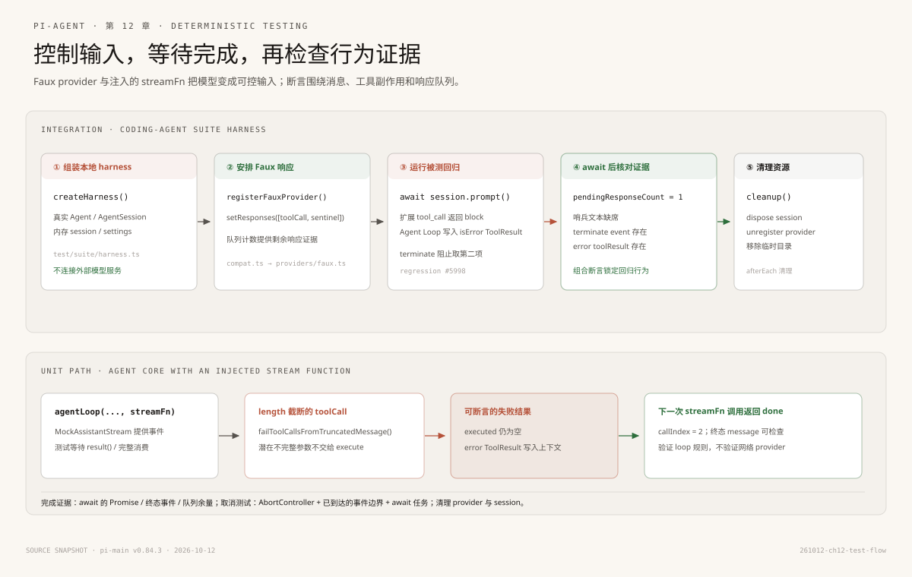

# 第12章：测试模式 —— 不用真实模型验证 Agent 行为

> 源码基准：本地 `pi-main` 快照，核心包版本 `v0.84.3`，核对日期 `2026-10-12`。下文路径均相对源码根目录。

上一章把扩展拦截链一路追到了模型：扩展返回 block，工具没有执行，Agent Loop 把错误结果放回消息，再决定是否请求模型。

如果每次验证都真的调用在线模型，测试就会变慢、受网络影响、消耗额度，模型回复变化也会让断言难以稳定。测试要验证的是 Agent 的行为约定，不是某家服务今天给出的随机措辞。

本章先走 coding-agent 的集成测试 harness，再缩到 Agent Core 的 streamFn 注入测试。两条路线都使用可控的模型响应，不需要调用真实服务或付费 token。



---

## 一、问题：一个测试要证明哪段行为

假设回归问题是：某个 tool_call 扩展返回 block 后，Agent 仍然继续请求模型，意外调用了第二轮响应。我们需要观察的并不是“模型是否聪明”，而是几个确定的状态：

- 扩展处理器是否被执行。
- 工具的 execute 是否真的没有运行。
- 工具错误结果是否写回消息。
- Agent 是否读取第二个排队响应，还是按 terminate 提示结束。
- 事件是否留下可断言的记录。

这些都由本地代码控制。测试可以把模型返回值设成一组已知响应，再等待 Agent 完成。这样测试同时可重复、可解释，还能准确指出违反了哪一条行为契约。

Pi 当前有两条可用测试层次：

| 层 | 入口 | 被一起验证的范围 |
|---|---|---|
| coding-agent suite harness | createHarness() + faux provider + AgentSession | coding-agent 会话、扩展注册、工具包装、Agent Loop 消费和事件 |
| Agent Core 单元测试 | agentLoop() + 显式 streamFn | 一次 Agent Loop 与自己提供的模型事件流 |

两者都能测试工具调用，但所覆盖的组装边界不同。测试说明需要跟实际文件对齐，不能只看旧文档里可能已经废弃的 provider 名称或脚本 API。

---

## 二、先看集成层：createHarness 组装了什么

测试夹具在 `packages/coding-agent/test/suite/harness.ts`。它不是“测试版假 Agent”，而是用 in-memory 基础设施组装当前 coding-agent 的一条运行链：

- 从 `@earendil-works/pi-ai/compat` 导入 `registerFauxProvider()`，把 faux stream 注册进兼容 Provider registry。
- 创建内存 SessionManager、SettingsManager 和 AuthStorage。
- 建立 ModelRuntime，把 faux Provider 的模型和 API 接进去。
- 使用传入的 extensionFactories 生成 inline extensions。
- 创建真实的 `Agent` 和 `AgentSession`，工具、扩展事件和会话消息仍走正常调用链。
- 收集 AgentSessionEvent 到 `events` 数组，测试结束时调用 `cleanup()` 释放 session、provider 和临时目录。

可以把这条组装路径看成：

```text
createHarness(options)
  ├─ registerFauxProvider()
  ├─ SessionManager.inMemory()
  ├─ SettingsManager.inMemory()
  ├─ AuthStorage.inMemory()
  ├─ ModelRuntime 绑定 faux provider
  ├─ createTestExtensionsResult(extensionFactories)
  ├─ new Agent({ streamFn: streamSimple, ... })
  ├─ new AgentSession({ agent, resourceLoader, ... })
  └─ subscribe() 收集 AgentSessionEvent
```

这里要分清两个源码层次：`packages/ai/src/providers/faux.ts` 导出底层 `createFauxCore()` 与 `fauxProvider()`，负责构造模型、流函数和响应队列；兼容层 `packages/ai/src/compat.ts` 的 `registerFauxProvider()` 调用 `createFauxCore()`，并把流注册进 Provider registry。Harness 从 `@earendil-works/pi-ai/compat` 导入后者。一个响应可以是 AssistantMessage，也可以是接收请求上下文、选项、状态与模型后动态生成消息的函数。测试使用 `setResponses()` 替换队列，`appendResponses()` 追加队列；`getPendingResponseCount()` 查看还没消费的响应数。

代码里会走 ModelRuntime 的 provider 接口，但最终没有 HTTP 请求。Faux 在本地流里产生 start、text、toolcall、done 或 error 事件，Agent Loop 仍按相同协议消费。

### 2.1 夹具里的扩展来自 inline factory

`HarnessOptions.extensionFactories` 支持把 ExtensionAPI 工厂传给测试。`createTestExtensionsResult()` 建立扩展加载结果，工具、事件处理器和资源注册仍由 coding-agent 的 ExtensionRunner 解析。

这让测试可以在一个文件内组装要验证的行为：

```typescript
const harness = await createHarness({
  extensionFactories: [
    (pi) => {
      pi.on("tool_call", async () => ({
        block: true,
        reason: "Blocked by test policy",
        terminate: true,
      }));
    },
  ],
});
```

inline factory 仍是同一个注册协议；它减少了路径发现、文件写入和 Jiti 加载的变量。若要覆盖目录扫描、TS 模块导入或 Jiti alias，还应针对相应 loader 路径编写测试，不能声称 harness 覆盖了磁盘扩展发现的全部行为。

---

## 三、实际回归：#5998 阻止工具后终止本次工具轮次

`packages/coding-agent/test/suite/regressions/5998-blocked-tool-terminate.test.ts` 是一个真实的回归用例。它关注上一章提到的 tool_call 终止提示。以下工具定义节选依赖该文件导入的 `AgentTool` 与 `Type`；测试的其他夹具来自 `createHarness()`。

测试创建一个 `echo` AgentTool。源码中的执行函数直接抛错，作为工具不应执行时的错误信号；随后通过 inline extension 注册 block handler。需要注意，Agent Loop 会把工具执行异常捕获并转换为错误 ToolResult，所以这个 throw 本身不保证让 Vitest 直接失败。

```typescript
const echoTool: AgentTool = {
  name: "echo",
  label: "Echo",
  description: "Echo text back",
  parameters: Type.Object({ text: Type.String() }),
  execute: async () => {
    throw new Error("tool should have been blocked");
  },
};
```

Faux 响应队列包含两项：

```typescript
harness.setResponses([
  fauxAssistantMessage(
    [fauxToolCall("echo", { text: "hello" })],
    { stopReason: "toolUse" },
  ),
  fauxAssistantMessage("should not run"),
]);
```

第一项让模型明确发起 `echo` 工具调用；第二项只是一个可识别的哨兵文本。如果 Agent 没因终止提示停止，它会请求第二项，助手消息里就会出现 `should not run`。

测试随后调用 `await harness.session.prompt("hi")`，等待这条 prompt 流程完成，再检查几个彼此独立的证据：

```typescript
expect(harness.getPendingResponseCount()).toBe(1);
expect(getAssistantTexts(harness)).not.toContain("should not run");
expect(harness.eventsOfType("tool_execution_end")[0]?.result)
  .toHaveProperty("terminate", true);
expect(
  harness.session.messages.find(
    (message) => message.role === "toolResult" && message.isError,
  ),
).toBeDefined();
```

每个断言回答一个问题：

| 证据 | 说明 |
|---|---|
| faux 队列剩 1 项 | Agent 没消费第二个模型响应 |
| assistant 文本没有哨兵句 | 第二轮 assistant 回复没有出现 |
| tool_execution_end.result.terminate 为 true | extension block 通过工具结果传到了终止判定 |
| session.messages 含 isError 的 toolResult | 被阻止的调用仍形成与工具调用关联的错误消息 |

这个测试没有只看一个最终 UI 文本。它同时检查 faux 响应队列、AgentSession event 和持久上下文，三种证据指向同一个闭环。

### 3.1 throw 是路径信号；计数器才是直接的未调用断言

echo 的 execute 故意 throw；这不是在模拟正确工具行为。不过，Agent Loop 会把 execute 抛出的异常编码成错误工具结果。因而“函数里 throw 了”不等于测试框架一定看见异常，也不能单独证明 execute 没被调用。原回归还断言了 `terminate: true` 的结果、错误 toolResult 和第二条 Faux 响应仍在队列；这些组合证据验证了阻止后终止的行为。

若测试目标还要直接证明工具函数从未进入，可以加调用计数器或 spy。下面是可放进同一回归测试的缩略写法，仍依赖测试文件里的 `AgentTool`、`Type` 和 `harness`：

```typescript
let executeCount = 0;
const countedEchoTool: AgentTool = {
  name: "echo",
  label: "Echo",
  description: "Count executions",
  parameters: Type.Object({ text: Type.String() }),
  execute: async () => {
    executeCount += 1;
    return { content: [{ type: "text", text: "executed" }], details: {} };
  },
};

// 创建 harness 并完成 await harness.session.prompt("hi") 后：
expect(executeCount).toBe(0);
```

这是加强测试的建议，不是 #5998 原文件里已有的断言。它把“execute 未调用”变成独立、直接的观测量。

### 3.2 为什么剩余响应比固定 sleep 更可靠

测试没有等 100 毫秒再猜 Agent 是否还会请求模型。它 await prompt 完成，再读取响应队列计数。运行完成是明确的同步点；队列计数是行为证据。

固定 sleep 只证明“某个时间点前没有看到动作”，不证明 Agent 已经走到终点。负向断言尤其需要先等待完整操作结束，再检查不应发生的事情没有发生。

### 3.3 这条回归验证的边界

该回归验证 inline extension、AgentSession、Faux provider 响应队列、tool_call block、错误 ToolResult 和 terminate 判定的组合行为。它没有启动实际 bash 或 echo 进程，也没有验证 shell 命令识别策略。

如果想验证另一条扩展工具注册路径，可以看 `packages/coding-agent/test/suite/regressions/2835-tools-allowlist-filters-extension-tools.test.ts`：它在 session_start 注册 dynamic_tool，然后检查工具 allowlist 是否同时过滤系统工具与 extension tool。它覆盖的是工具注册、激活和 system prompt，不是模型 tool-call 执行链。

---

## 四、再缩到 Agent Core：显式注入 streamFn

coding-agent harness 覆盖较多组装逻辑；如果只想验证 Agent Loop 本身，就不必创建 ModelRuntime 和 AgentSession。

`packages/agent/test/agent-loop.test.ts` 直接调用 `agentLoop()`，传入本地 `MockAssistantStream` 返回的 streamFn。测试可以自己决定每次调用返回什么消息。下面是说明注入点的教学节选，依赖该测试文件里的 `MockAssistantStream`、`createAssistantMessage()`、`createUserMessage()` 和 loop 所需的 `context/config` 夹具；它不是可脱离测试文件单独运行的完整测试。

一个最小的 streamFn 框架：

```typescript
const streamFn = () => {
  const stream = new MockAssistantStream();
  queueMicrotask(() => {
    const message = createAssistantMessage(
      [{ type: "text", text: "完成" }],
      "stop",
    );
    stream.push({ type: "done", reason: "stop", message });
  });
  return stream;
};

const stream = agentLoop(
  [createUserMessage("执行检查")],
  context,
  config,
  undefined,
  streamFn,
);

const messages = await stream.result();
```

`MockAssistantStream` 是基于 Agent Core 使用的 EventStream 协议构造的测试流。响应通过微任务推入，测试等待 `stream.result()` 或消费整个事件流；这不是用 sleep 猜模型何时完成。

streamFn 接收 model、Context 和 stream options。纯 loop 测试可以忽略不相关字段，也可以在函数里根据调用计数和上下文消息动态返回不同 AssistantMessage。若要验证先工具、再最终回答，测试就返回两次消息：

1. 第一次 AssistantMessage 含 toolCall，stopReason 为 toolUse。
2. Agent Loop 执行工具并追加 toolResult。
3. 第二次 AssistantMessage 返回普通文本，stopReason 为 stop。
4. 测试检查工具副作用、消息顺序、事件和最后的 assistant 响应。

真实 provider 不参与这段测试；协议事件仍然按 Agent Loop 的消费者实现传递。

### 4.1 两种 Faux 接口各在不同层

`packages/ai/src/providers/faux.ts` 提供低层 Faux 实现：

- `fauxAssistantMessage()` 生成标准 AssistantMessage。
- `fauxToolCall()` 生成带 id、工具名和参数的 ToolCall。
- `createFauxCore()` 构造共用流实现；`fauxProvider()` 把它包装成可挂入 `Models` 集合的 Provider handle。
- `setResponses()` 和 `appendResponses()` 控制响应队列。
- 队列用完会产出 stopReason 为 error 的消息，错误内容为 No more faux responses queued。
- 若响应工厂抛错，Faux 也会结束流并产出 error 事件。

coding-agent suite harness 使用 compat 层的 `registerFauxProvider()`；它位于 `packages/ai/src/compat.ts`，内部复用 `createFauxCore()` 并注册流。Agent Core 单元测试常直接传入自制 streamFn 和 MockAssistantStream。要区分这两条路径：前者验证 provider 接口到 coding-agent 的接线，后者聚焦 Agent Loop。

---

## 五、第二条单元测试链路：被截断的 tool call 不执行

同一个 `agent-loop.test.ts` 还展示一个重要边界：当 assistant 输出以 `stopReason: "length"` 结束时，tool-call 参数可能被截断。即使 salvaged JSON 看起来能通过 schema，也不能假设参数完整。

该测试提供一个 echo 工具，把任何实际执行的参数放进 `executed` 数组。streamFn 第一次返回一个带参数 `{ value: "hel" }` 的 toolCall，同时标记 length；第二次返回文本 done。

```text
第一次模型消息:
  stopReason = length
  toolCall = echo({ value: "hel" })

Agent Loop:
  不执行 tool
  tool_execution_end.isError = true
  ToolResult 文本说明输出达到 token limit
  再请求一次模型

第二次模型消息:
  assistant: "done"
```

断言包括：

```typescript
expect(executed).toEqual([]);
expect(toolEnd).toBeDefined();
expect(toolEnd.isError).toBe(true);
expect(text).toContain("output token limit");
expect(callIndex).toBe(2);
expect(messages[messages.length - 1].role).toBe("assistant");
```

这里的核心不是收到 length 就全局重试，而是 Agent Loop 对这一条带有截断工具调用的消息执行安全分支：把每个潜在不完整的调用转换成错误结果，再请求模型重新发出完整调用。模型仍可能给出不完整结果；单元测试只验证当前确定的算法行为。

这条测试直接检验工具调用的失败与恢复，没有依赖测试 harness，也没有 HTTP 或 sleep。

---

## 六、没有真实模型时，错误、取消和恢复怎么设计

稳定测试要主动安排每种结果，而不是祈求服务端刚好返回它。

### 6.1 Faux 队列耗尽是配置错误的信号

如果 Agent 额外请求了一次，但测试没有排队后续响应，Faux 会生成带 error stop reason 的 AssistantMessage，原因包含 `No more faux responses queued`。测试可以检查调用次数或 error 事件，从而发现“循环次数比预期更多”。

不要把这个错误当成测试预期输出后就忽略。大多数情况下，队列意外耗尽说明 Agent 走到了未预期的下一轮，或者测试漏排了真实需要的响应。

### 6.2 streamFn 抛错和 error 事件是两种注入

streamFn 的调用本身可能同步抛出异常；也可能返回一个流，之后由流结束为 error 事件。后者更贴近 provider 将网络、解析异常编码为终态事件的路径。

为验证 Agent Loop 的事件消费者，优先构造正确终态的 AssistantMessageEventStream。若要验证同步 throw 的边界，则单独写测试，并明确它绕过了流内 error 事件路径。

### 6.3 cancellation 要由 AbortSignal 驱动

Faux provider 在分块生成内容时检查传入的 `AbortSignal`。测试取消时，应触发明确的 AbortController，再等待事件流结束，检查终态为 aborted、工具没有执行或其他对应状态。

不要调用一个迟疑多久就自然结束的 sleep，把它当成取消测试。竞态测试应等待可观察的事件或 Promise，确认取消发生在指定阶段后再继续。

下面是展示同步点的测试结构节选，不是 faux 源码本身。`operation` 必须在收到 signal 后结束；`reachedBoundary` 由测试中的可观察事件或受控 Promise 完成，表示取消时机已经确定：

```typescript
async function cancelAtKnownBoundary<T>(
  operation: (signal: AbortSignal) => Promise<T>,
  reachedBoundary: Promise<void>,
): Promise<T> {
  const controller = new AbortController();
  const task = operation(controller.signal);
  await reachedBoundary;
  controller.abort();
  return await task;
}
```

### 6.4 cleanup 让 faux provider 与临时目录可重复使用

coding-agent harness 的 `cleanup()` 会 dispose session、unregister Faux Provider，并移除临时目录。测试套件中可以在 `afterEach()` 逐个清理所有建立过的 harness。

资源释放是测试行为的一部分：若 Provider 注册残留到下一个测试，同名模型或响应队列会相互影响；若 session 未 dispose，订阅监听也会污染事件断言。

---

## 七、组织测试：断言行为契约，不镜像实现细节

上面两条路线验证的是不同层次。选择测试入口时，按要保护的契约决定范围：

- 要验证编码给 coding-agent 的用户路径，例如 extension handler → tool block → session message，使用 suite harness。
- 要验证 Agent Core 的 loop 规则，例如截断工具调用失败后如何请求下一轮，直接注入 streamFn。
- 要验证 AI 层 Faux 的响应、usage、error 事件，使用 packages/ai/test/faux-provider.test.ts。
- 要验证磁盘发现、Jiti 导入或 package alias，单测 loader 或 resource discovery。
- 要验证真正的 bash 进程行为，单独使用执行器测试或受控 shell 环境，不要因为 harness 使用内存会话就误以为它验证了操作系统进程。

对于每条测试，最好写清楚：

1. 输入是什么：模型响应、扩展 handler、工具参数。
2. 允许发生什么：工具结果、Agent 事件、下一次模型调用。
3. 不允许发生什么：工具 execute 未运行、队列没有多消费一项。
4. 完成证据是什么：await 结束、终态事件、Promise 完成或队列计数。
5. 清理如何进行：provider 注销、session dispose、临时文件删除。

这能帮助下一个读者分清“测试运行成功”和“行为证据充分”是两个判断。

---

## 八、新 AgentHarness scaffold 不等于当前稳定测试运行时

Pi 的 `AgentHarness` 与 coding-agent suite harness 不是同一个东西。

- 本章主要使用的 `createHarness()` 位于 `packages/coding-agent/test/suite/harness.ts`，是 coding-agent 测试目录里的测试夹具。它确实组装了 AgentSession、内存 SessionManager、ResourceLoader、Faux provider 和 inline extensions。
- `packages/agent/src/harness/agent-harness.ts` 是 agent-core 的新通用宿主门面。当前快照中的若干运行入口还会返回 `HarnessNotImplemented`；导出这个类和类型不能推断其测试 scaffold 已经完成端到端运行。
- `agentLoop()` 及 `Agent` 的现有代码可独立运行并有对应测试；不要因为 AgentHarness 部分未实现，就把所有 agent-core 测试说成脚手架假测试。

调查新模块时，沿着实际方法体和调用者判断成熟度。测试名字、导出类型和使用示意可以指路，但通过断言的证据来自可执行分支。

---

## 九、下一站

现在有两种清晰的控制方式：在 coding-agent harness 中测完整的 session + extension + tool 路径；或在 Agent Core 中注入 streamFn，只测循环的一条规则。

下一步可以继续沿源码看如何测试会话恢复、压缩、工具并发和 abort：选定输入状态，安排模型流或 handler 返回值，等待确定的完成点，再检查消息、状态与事件。无需真实模型账户，也不需要让测试依赖网络运气。

---

> **本章关键源码索引**
>
> - packages/coding-agent/test/suite/harness.ts — HarnessOptions、createHarness、Faux Provider 与内存 AgentSession 组装、事件记录、cleanup
> - packages/coding-agent/test/suite/regressions/5998-blocked-tool-terminate.test.ts — 扩展阻止工具调用、terminate、剩余 faux 响应和错误 toolResult 的回归测试
> - packages/coding-agent/test/suite/regressions/2835-tools-allowlist-filters-extension-tools.test.ts — session_start 注册 extension tool、allowlist 与 system prompt 断言
> - packages/agent/test/agent-loop.test.ts — MockAssistantStream、agentLoop、streamFn 注入、length 截断工具调用测试
> - packages/agent/src/agent-loop.ts — streamAssistantResponse、prepareToolCall、failToolCallsFromTruncatedMessage、executeToolCalls
> - packages/ai/src/providers/faux.ts — FauxResponseStep、fauxAssistantMessage、fauxToolCall、createFauxCore、fauxProvider
> - packages/ai/src/compat.ts — registerFauxProvider；包装 createFauxCore 并注册 Faux API streams
> - packages/ai/test/faux-provider.test.ts — Faux provider 的 tool call、排队响应、usage 与 error 测试
> - packages/agent/src/harness/agent-harness.ts — 当前通用 AgentHarness 的已实现与未实现边界
