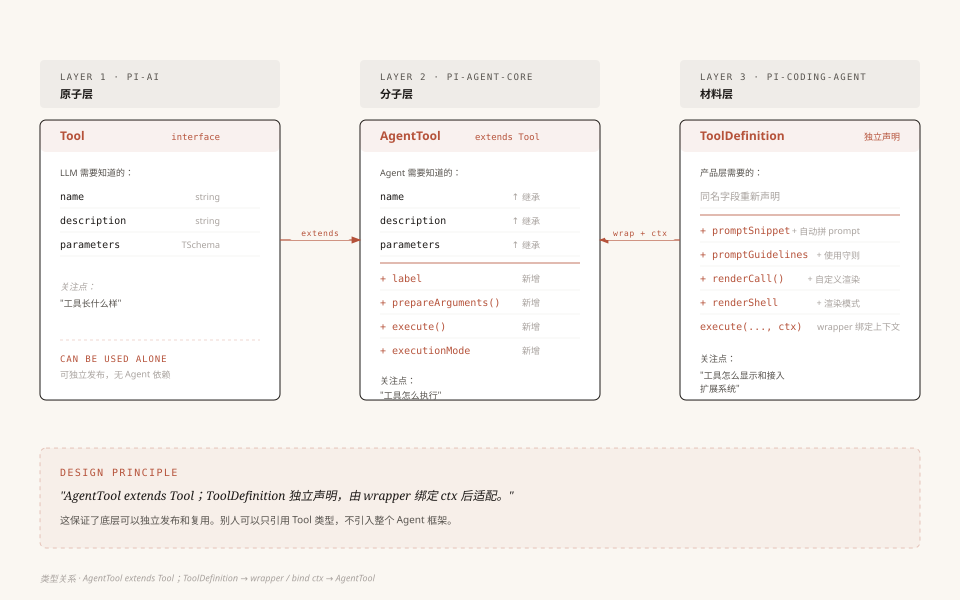

# 第2章：三层架构 —— Pi-Agent 项目的骨骼

> 本章我们站在高处，把 Pi 的整体架构看清楚——代码放在哪里、包之间怎么依赖、类型怎么在层与层之间流转。理解了这幅全景图，后面再钻进任何一个模块都不会迷路。

> 源码基准：本地 `pi-main` 快照，核心包版本 `v0.84.3`，核对日期 `2026-10-12`。下文路径均相对源码根目录。

---

## 1. 你打开了一个 Agent 代码库

假设你第一次克隆了 Pi 的代码库，在终端里敲下 `ls`，你会看到这样的目录结构：

```
repo/
├── packages/
│   ├── ai/              ← @earendil-works/pi-ai
│   ├── agent/           ← @earendil-works/pi-agent-core
│   ├── coding-agent/    ← @earendil-works/pi-coding-agent
│   ├── tui/             ← @earendil-works/pi-tui
│   ├── telemetry/       ← @earendil-works/pi-telemetry
│   ├── protocol/        ← @earendil-works/pi-protocol
│   ├── client/          ← @earendil-works/pi-client
│   ├── server/          ← @earendil-works/pi-server（实验性）
│   ├── session-backends/
│   │   └── sqlite-node/ ← @earendil-works/pi-session-backend-sqlite-node
│   └── evals/          ← 内部评估工具，private package
├── package.json         ← 根配置，npm workspaces
└── tsconfig.json
```

目录比“三层”多得多。先别急着把每个目录都算成一层——**包是发布和依赖的边界，层是我们理解职责的方式，两者不是一一对应的。**

本地快照里没有 `packages/orchestrator/`。因此这一章只解释当前能找到的包，不把旧版本的目录继续画进现在的架构。

如果你做过 Node.js 项目，大概率用过 monorepo（把多个包放在一个仓库里管理）。Pi 用的就是标准的 npm workspaces 方案——根目录的 `package.json` 除了 `"packages/*"`，还声明了 `"packages/session-backends/*"` 和部分扩展示例目录。npm 根据这些模式管理各个带 `package.json` 的工作区；`session-backends/` 自己只是分类目录，真正的包在它下面。

但这不是重点。重点是：**为什么要分成这些包？核心三件套和存储、传输、显示这些配套能力是什么关系？能不能合并？**

要回答这个问题，我们需要先搞清楚每个包到底在干什么。

---

## 2. 核心三件套与配套包，各管各的

先不要管依赖关系，我们从每个包自己的视角看它在做什么。

### 2.1 pi-ai：管"调模型"

`@earendil-works/pi-ai`（源码在 `packages/ai/`）解决的问题是：**怎么用一套代码调用不同的 LLM？**

它的 `package.json` 里写了这么一行描述：

> "Unified LLM API with automatic model discovery and provider configuration"（统一 LLM API，支持自动模型发现和提供商配置）

具体来说，它做了三件事：

1. **定义统一的类型**：不管你用 OpenAI、Anthropic、Google 还是 AWS Bedrock，消息格式都是一样的——`UserMessage`、`AssistantMessage`、`ToolResultMessage`，模型定义都是 `Model<TApi>`
2. **统一流式调用**：`Models.streamSimple()` 接收统一上下文，返回 `AssistantMessageEventStream`（可以逐增量读取的流）；旧的全局函数则保留在 `compat` 子入口
3. **拆开提供商与协议适配**：`providers/` 管“这家服务有哪些模型、怎样认证”，`api/` 管“它使用的协议怎样发送和解析”。多个提供商可以共用同一种 API 实现

你看它的 `index.ts` 导出了什么就知道了：

```typescript
// packages/ai/src/index.ts（节选，省略了与本节无关的导出）
// 顶部注释明确写：Core only, side-effect free: no generated catalogs,
// no provider factories, no api-registry, no OAuth implementations, no compat.
// 全局 API 注册表、stream/complete 函数等已迁至 ./compat.ts（packages/ai/src/compat.ts）
export type { Static, TSchema } from "typebox";
export { Type } from "typebox";
export * from "./api/lazy.ts";            // API 懒加载与外层事件流
export * from "./auth/context.ts";        // 认证上下文
export * from "./auth/credential-store.ts";
export * from "./models.ts";              // createModels / createProvider
export * from "./models-store.ts";        // 模型目录缓存接口
export * from "./types.ts";               // 统一类型
export * from "./utils/event-stream.ts";  // 事件流基类
// Provider 工厂：@earendil-works/pi-ai/providers/*
// 旧全局 stream / streamSimple：@earendil-works/pi-ai/compat
```

它定义了 `Tool` 的名称和参数 schema，因为模型需要看到工具的“名片”；但它不执行工具，也不跑 Agent Loop。它负责：**把 LLM API 的差异抹平，对外暴露一套统一的接口**。

### 2.2 pi-agent-core：管"跑循环"

`@earendil-works/pi-agent-core`（源码在 `packages/agent/`）解决的问题是：**怎么让 LLM 反复思考和行动？**

它的 `package.json` 描述是：

> "General-purpose agent with transport abstraction, state management, and attachment support"（通用 Agent 框架，支持传输抽象、状态管理和附件支持）

关键词是 **"general-purpose"（通用的）**。这个包不知道自己在做编程 Agent、客服 Agent 还是任何具体领域的 Agent。它只知道：

- 怎么维护对话状态（`AgentState`）
- 怎么跑一个"调用 LLM → 执行工具 → 再调用 LLM"的循环（`agentLoop`）
- 怎么在循环过程中发出事件，让外部知道发生了什么（`AgentEvent`）
- 怎么定义可持久化的会话抽象与压缩工具（`Session`、`compact`）；这些能力由宿主组装，不会由 `Agent` 自动启用
- 怎么把文件和 Shell 操作封装成可注入执行环境的 Harness 工具

看它的 `index.ts` 导出：

```typescript
// packages/agent/src/index.ts（节选）
export * from "./agent.ts";                    // Agent 类
export * from "./agent-loop.ts";               // 循环函数
export * from "./harness/agent-harness.ts";     // 新 Harness 门面
export * from "./harness/session/index.ts";    // 会话管理
export * from "./harness/tools/index.ts";      // read / bash / edit / write 工厂
export * from "./types.ts";                    // 类型定义
// compact 等函数另从 harness/compaction/compaction.ts 具名导出
```

这就出现了一个容易误判的地方：**通用框架不等于“只能有循环、绝不能有工具实现”。** 当前 agent-core 已经有 `read`、`bash`、`edit`、`write` 工厂，但通过 `ExecutionEnv` 接口使用文件系统和 Shell。Node 环境适配从 `@earendil-works/pi-agent-core/node` 单独导出；核心工具不直接绑定 coding-agent 的终端界面和扩展系统。

换句话说，agent-core 可以提供“怎么读文件”的机制，而 coding-agent 决定“读完怎么显示、工具提示怎样拼到人设里、扩展从哪儿介入”。包的职责边界看的是依赖和接口，不是文件名里有没有 `read`。

> 还有一个需要分开的概念：`Agent` 已经能跑循环，`AgentHarness` 则是新的会话运行门面。在本地快照里，后者的 `prompt()`、`compact()`、`navigateTree()` 等方法仍返回 `HarnessNotImplemented`。**导出了类型和类，不代表所有运行能力都已实现。** 后面讲循环时仍沿着 `Agent → agentLoop` 这条可运行主线走。

### 2.3 pi-coding-agent：管"具体业务"

`@earendil-works/pi-coding-agent`（源码在 `packages/coding-agent/`）解决的问题是：**怎么做一个编程助手？**

它的 `package.json` 描述是：

> "Coding agent CLI with read, bash, edit, write tools and session management"（编程 Agent CLI，提供读、执行、编辑、写工具和会话管理）

这一层是最"厚"的——上百个源文件，比前两层加起来还多。因为它知道所有具体的事：

- 7 个编程工具（read、bash、edit、write、grep、find、ls）怎么实现
- 扩展系统怎么加载和运行
- 会话怎么持久化到磁盘
- CLI 怎么解析参数、怎么在终端渲染输出
- 认证信息怎么存储

它的入口是 `cli.ts`，用户在终端输入 `pi` 命令时，就从这里启动：

```typescript
// packages/coding-agent/src/cli.ts（入口摘录；shebang 在源码首行，此处省略）
import { APP_NAME } from "./config.ts";
import { configureHttpDispatcher } from "./core/http-dispatcher.ts";
import { main } from "./main.ts";

process.title = APP_NAME;
process.env.PI_CODING_AGENT = "true";
process.env.AI_AGENT = "pi";
process.emitWarning = (() => {}) as typeof process.emitWarning;
configureHttpDispatcher();
main(process.argv.slice(2));
```

一个简单的入口，背后是一整条启动链路：

```
你输入: pi "帮我改个 bug"
│
├── cli.ts          ← 设置进程环境、初始化 HTTP dispatcher，调用 main
└── main.ts         ← 解析参数并创建 SessionManager
    └── createAgentSessionRuntime(createRuntime)
        └── createRuntime()
            ├── createAgentSessionServices()       ← SettingsManager、ModelRuntime、ResourceLoader
            └── createAgentSessionFromServices()
                └── AgentSession                  ← 接上 SessionManager、工具和扩展
                    └── Agent → agentLoop()       ← Agent 管状态与循环
    └── 选择 interactive / print / RPC 模式并运行
```

`Agent` 本身不会自动写盘或压缩。`pi-agent-core` 的 `Session` 是通用会话抽象，`compact` 是独立能力；`pi-coding-agent` 用自己的 `SessionManager` 与 `AgentSession` 把持久化、工具和 Agent 接起来。

### 2.4 pi-tui：管"显示"

这个包是 UI 层：

- **pi-tui**：终端 UI 库，负责在终端里渲染 Markdown、代码高亮、差分显示。它的依赖里**没有任何 AI 相关的包**——运行时仅 `marked`（Markdown 渲染）+ `get-east-asian-width`（东亚字符宽度计算）；`chalk`、`@xterm/headless` 在 devDependencies，不打包进运行时

这个包和"Agent 怎么工作"没有直接关系，它只是负责把 Agent 的工作过程展示给用户看。后面的学习中我们不会深入这一层。

### 2.5 配套包：管“传输、存储和观测”

假设你已经用核心三件套做出一个 Agent。接下来想让另一个进程控制它、把会话存到数据库、查看一轮请求发生了什么。这些需求各有自己的边界：

| 包 | 解决什么问题 | 不需要知道什么 |
|---|---|---|
| `pi-protocol` | 远程请求、响应、事件的数据格式，以及 CBOR 编码和帧边界 | 不调用模型、不运行 Agent |
| `pi-client` | 通过字节传输控制远程会话，关联请求和响应、维护会话租约 | 不直接执行服务端工具 |
| `pi-server` | 接收连接，把协议命令交给应用提供的会话服务 | 不替应用决定模型、工具和存储实现 |
| `pi-session-backend-sqlite-node` | 为 agent-core 会话提供 SQLite repository、迁移与可选全文搜索 | 不负责 CLI 渲染 |
| `pi-telemetry` | 定义显式传递的遥测上下文、span 和 schema | 不绑定某个导出平台，不调模型 |
| `pi-evals` | 内部评估脚本与测试 | 不作为这条学习主线的 SDK 入口 |

这不是把三个核心层变成十层，而是在不同边界放不同的适配能力。比如 `pi-client` 依赖 `pi-protocol`，却不依赖 `pi-ai`；远程客户端只需要理解协议，不需要把各家模型 SDK 都装进自己的进程。

依赖清单也能印证这条边界：`pi-client` 直接依赖 `pi-protocol`；标记为 experimental 的 `pi-server` 直接依赖 `pi-ai` 与 `pi-protocol`。这两个包分别承担传输客户端和协议服务端职责，不必硬塞进核心三层。

> `pi-server` 的包描述标为实验性；`AgentHarness` 也有尚未实现的方法。阅读新模块时，要继续追到方法体和组装位置，不能只按 README 的使用示意判断完成程度。

---

## 3. 看完这些包，你大概有了直觉

读完上面那一段，你脑子里可能已经有了一个画面：

```
┌─────────────────────────────────────────────┐
│  pi-coding-agent：我知道怎么写代码            │  ← 最懂业务
│  （工具、扩展、CLI、会话持久化）               │
├─────────────────────────────────────────────┤
│  pi-agent-core：我知道怎么跑 Agent            │  ← 只懂框架
│  （循环、状态、事件、会话、通用工具机制）      │
├─────────────────────────────────────────────┤
│  pi-ai：我知道怎么调模型                      │  ← 只懂模型
│  （统一类型、模型目录、认证、协议适配）        │
└─────────────────────────────────────────────┘

旁边还有一个独立的 UI 包：
┌──────────┐
│  pi-tui  │  ← 只管显示
└──────────┘
```

很直觉的分层：底层调模型，中间跑循环，顶层做业务。对吧？

但等等——

---

## 4. 打开 package.json，事情没那么简单

> **阅读路径提示**：第 4-5 节是**架构理解进阶**，深入依赖关系和类型流转的细节。第 4 节修正"严格分层"的常见误解、讲清依赖方向——**如果你打算基于 SDK 二次开发，这一节必读**；第 5 节展开三层类型字段递进，更偏类型系统细节，记不住字段不影响后续学习。**只想快速用起来的读者，可以跳过这两节，直接去第 6 节看"分层承诺怎么兑现"。**

如果你的分层理解是"上层只能依赖相邻的下层"，那打开 `packages/coding-agent/package.json` 的 `dependencies` 字段，你会看到一个意料之外的细节：

```jsonc
// packages/coding-agent/package.json
"dependencies": {
    "@earendil-works/pi-agent-core": "^0.84.3",   // ← 依赖中间层，合理
    "@earendil-works/pi-ai": "^0.84.3",           // ← 也直接依赖底层？
    "@earendil-works/pi-tui": "^0.84.3",
    "@earendil-works/pi-client": "^0.84.3",
    "@earendil-works/pi-protocol": "^0.84.3",
    // ... 其他依赖
}
```

coding-agent **直接依赖了 pi-ai**，而不是只通过 pi-agent-core 间接使用它。

如果你之前认为分层就是"隔一层调一层"（就像网络协议栈那样），这个发现会让你愣一下：这不是打破分层了吗？为什么顶层要跨层直接引用底层的东西？

### 答案藏在类型系统里

打开 `packages/agent/src/types.ts` 的第一行，你会看到：

```typescript
// packages/agent/src/types.ts（节选）
import type {
    Api,
    AssistantMessage,
    AssistantMessageEvent,
    AssistantMessageEventStream,
    Context,
    ImageContent,
    Message,
    Model,
    SimpleStreamOptions,
    TextContent,
    Tool,
    ToolResultMessage,
} from "@earendil-works/pi-ai";
```

pi-agent-core 的类型定义里，大量基础类型都是从 pi-ai 导入的：`Message`、`Model`、`ImageContent`、`Tool`…… 这些是整个系统的"原子概念"——就像化学元素一样，不管你在哪一层，都需要用到"原子"的定义。

同样，coding-agent 也需要直接用到 pi-ai 的类型。比如用户往聊天里贴了一张截图，coding-agent 需要知道图片数据用什么格式表示——这个 `ImageContent` 类型就定义在 pi-ai 里。

所以 coding-agent 直接依赖 pi-ai 不是设计失误，而是**必然**——某些基础类型必须在一处统一定义，所有层都引用这一处。

### 那分层的规则到底是什么？

关键不在于"能不能跨层引用"，而在于**依赖方向是不是单向的**。

我们来验证一下。看看每个包的 `dependencies` 里有没有反向依赖：

| 包 | 依赖了谁 | 有没有反向依赖？ |
|---|---------|---------------|
| pi-ai | 各家 SDK、pi-telemetry 等 | 不依赖 agent-core 或 coding-agent |
| pi-agent-core | pi-ai、pi-telemetry、typebox、yaml 等 | 不依赖 coding-agent |
| pi-coding-agent | pi-ai、pi-agent-core、pi-tui、pi-client、pi-protocol 等 | 消费底层和配套能力，不形成对核心层的反向依赖 |

用一张图表示：

```
pi-ai（底层）
  ↑         ↑
  │         │
  │    pi-agent-core（中间层）
  │         ↑
  │         │
  └─── pi-coding-agent（顶层）
```

图中的箭头表示“被谁使用”：下层提供能力，上层使用它。实际 `import` 方向则相反，是上层引用下层。**核心底层不知道上层的存在**——pi-ai 不依赖 pi-agent-core 或 pi-coding-agent，agent-core 不依赖 coding-agent。这就是分层的规则：**可以跨层引用，但不能形成反向依赖或依赖环。**

`pi-telemetry` 是另一个公共支撑包：ai 和 agent-core 都依赖它，而它不依赖这两个包。整个依赖图因此是有分支的，不是所有包排成一根线。

有人可能会问：那 pi-tui 呢，它也是底层的吗？

pi-tui 的运行时依赖只有 `marked`（Markdown 渲染）和 `get-east-asian-width`（东亚字符宽度），**没有任何 pi-xxx 包**。它不依赖 pi-ai，也不依赖 pi-agent-core。它就是一个独立的终端渲染工具。pi-coding-agent 依赖 pi-tui，把它当工具用，不存在循环依赖。

> 代码来源：各包 `package.json` 的 `dependencies` 字段。`packages/ai/src/types.ts` 定义了 `KnownApi`、`KnownProvider` 和基础消息类型；图只展示核心三件套，配套包的依赖需分别查看。

---

## 5. 类型在层间的流转：从原子到分子

理解了依赖方向之后，下一个问题是：**类型怎么在层与层之间传递？**

还是用化学做类比。pi-ai 定义了"原子"（最基础的类型），pi-agent-core 把原子组合成"分子"（Agent 专用类型），pi-coding-agent 再把分子组合成"材料"（业务专用类型）。

### 第一层：pi-ai 定义原子

```typescript
// packages/ai/src/types.ts（节选）
import type { TSchema } from "typebox";

// 最基础的消息类型——所有 LLM 都认的格式
type Message = UserMessage | AssistantMessage | ToolResultMessage;

// 模型定义（简化示意，只列出本节关心的字段）
interface Model<TApi extends Api> {
    id: string;           // 如 "claude-sonnet-4-6"
    name: string;
    api: TApi;            // 如 "anthropic-messages"
    contextWindow: number; // 如 200000
    // 其余 Model 字段省略
}

// 工具定义——描述一个工具的 schema（实际泛型约束来自 TypeBox）
interface Tool<TParameters extends TSchema = TSchema> {
    name: string;
    description: string;
    parameters: TParameters;
    constrainedSampling?: false | ConstrainedSamplingConfig;
}
```

这里的 `Model` 和 `Tool` 都是为讲解而缩短的源码摘录：其余 `Model` 字段省略，`Api` 与 `ConstrainedSamplingConfig` 在同一源码模块中定义，`TSchema` 从 `typebox` 导入；展示的字段类型与源码保持一致。

这三个类型——`Message`、`Model`、`Tool`——就是整个 Pi 系统的原子。任何包只要和 LLM 打交道，都必须用到它们。

### 第二层：pi-agent-core 把原子组合成分子

```typescript
// packages/agent/src/types.ts（节选）
import type { Message, Tool } from "@earendil-works/pi-ai";
import type { Static, TSchema } from "typebox";

// 扩展消息：除了标准 LLM 消息，还可以有自定义消息
type AgentMessage = Message | CustomAgentMessages[keyof CustomAgentMessages]

// 扩展工具：除了 schema，还有参数预处理、执行函数和执行模式
// CustomAgentMessages、AgentToolResult 等类型也在同一源码文件中定义
interface AgentTool<TParameters extends TSchema = TSchema, TDetails = any> extends Tool<TParameters> {
    label: string;
    prepareArguments?: (args: unknown) => Static<TParameters>;
    execute: (
        toolCallId: string,
        params: Static<TParameters>,
        signal?: AbortSignal,
        onUpdate?: AgentToolUpdateCallback<TDetails>,
    ) => Promise<AgentToolResult<TDetails>>;
    executionMode?: ToolExecutionMode;
}
```

该例保留源码的泛型默认值（`TDetails = any`），并省略注释与无关字段；TypeBox 类型从 `typebox` 导入，`AgentToolResult`、`AgentToolUpdateCallback` 和 `ToolExecutionMode` 在同一源码模块中定义。

注意两件事：

1. **`AgentMessage` 是 `Message` 的超集**。`Message` 是只有三种标准消息（User/Assistant/ToolResult），`AgentMessage` 在此基础上加入了自定义消息（如压缩摘要、分支信息等）。用 TypeScript 的联合类型（`|`）实现扩展，而不是修改原来的类型定义。
2. **`AgentTool` 继承了 `Tool`**。底层的 `Tool` 只知道"工具叫什么、参数是什么"（这是 LLM 需要知道的信息），上层的 `AgentTool` 加上了"怎么执行、串行还是并行"（这是 Agent 循环需要知道的信息）。

### 第三层：pi-coding-agent 把分子组合成材料

到了 coding-agent 层，类型变成了具体的业务定义：

```typescript
// packages/coding-agent/src/core/extensions/types.ts（简化节选）
import type { AgentToolResult, AgentToolUpdateCallback, ToolExecutionMode } from "@earendil-works/pi-agent-core";
import type { ConstrainedSamplingConfig } from "@earendil-works/pi-ai";
import type { Static, TSchema } from "typebox";
// 工具定义（产品视角）——完整接口字段更多；这里只列关键字段
// 注意：ToolDefinition 在 TypeScript 层面是独立 interface 重新声明，
// execute 多了 ExtensionContext，需由 wrapper 绑定，才可交给 Agent Loop
interface ToolDefinition<TParams extends TSchema = TSchema, TDetails = unknown> {
    name: string;
    label: string;
    description: string;
    promptSnippet?: string;
    promptGuidelines?: string[];
    parameters: TParams;
    constrainedSampling?: false | ConstrainedSamplingConfig;
    renderShell?: "default" | "self";
    prepareArguments?: (args: unknown) => Static<TParams>;
    executionMode?: ToolExecutionMode;
    execute: (
        toolCallId: string,
        params: Static<TParams>,
        signal: AbortSignal | undefined,
        onUpdate: AgentToolUpdateCallback<TDetails> | undefined,
        ctx: ExtensionContext,
    ) => Promise<AgentToolResult<TDetails>>;
    // renderCall / renderResult 及其 TState 泛型在源码中另有定义，此处省略
}

// 扩展定义（运行时聚合体，省略可选的渲染与转换字段）
interface Extension {
    path: string                                       // 扩展路径
    resolvedPath: string                               // 解析后的绝对路径
    sourceInfo: SourceInfo                             // 来源信息
    handlers: Map<string, HandlerFn[]>                 // 各类处理器
    tools: Map<string, RegisteredTool>                 // 注册的工具（Map，非 Record）
    messageRenderers: Map<string, MessageRenderer>     // 消息渲染器
    commands: Map<string, RegisteredCommand>           // 注册的命令（Map，非 Record）
    flags: Map<string, ExtensionFlag>                  // 扩展标志
    shortcuts: Map<KeyId, ExtensionShortcut>           // 快捷键绑定
}
```

### 类型关系与适配边界

`AgentTool` 确实通过 `extends` 扩展 pi-ai 的 `Tool`。coding-agent 的 `ToolDefinition` 则是独立声明的注册契约；它有同名字段，但 `execute` 还需要 `ExtensionContext`，不能直接当作 `AgentTool` 传给循环。把源码关系并排写出来：

```
Tool<TSchema>
    └─ AgentTool<TSchema> extends Tool<TSchema>

ToolDefinition<TSchema>  --wrapToolDefinition / bind ExtensionContext-->  AgentTool<TSchema>
```

`wrapToolDefinition()` 把 `ToolDefinition.execute` 所需的上下文绑定起来，再生成四参数形状的 `AgentTool.execute`；扩展工具还会经过 `packages/coding-agent/src/core/extensions/wrapper.ts` 的 `wrapRegisteredTool()`。**不能因为字段看起来相似，就把带第五个必需参数的 `execute` 原样传给只提供四个参数的循环。**

pi-ai 的 `Tool` 接口里没有 `execute`，因为 LLM 不需要执行函数。它现在还有可选的 `constrainedSampling`（告诉 Provider 是否约束工具参数生成）；这属于模型侧参数约束，仍然不是本地工具执行逻辑。



**配图说明**：三列对比 `Tool`、`AgentTool` 与 `ToolDefinition`。中间层用继承扩展执行能力；产品层独立声明更丰富的工具契约，再由 wrapper 绑定上下文并适配成 `AgentTool`。LLM 只看 schema，Agent Loop 执行工具，coding-agent 负责 prompt 提示、扩展接入和渲染。

> 代码来源：`packages/ai/src/types.ts` 的 `Tool`；`packages/agent/src/types.ts` 的 `AgentMessage`、`AgentTool`；`packages/coding-agent/src/core/extensions/types.ts` 的 `ToolDefinition`、`Extension`；`packages/coding-agent/src/core/extensions/wrapper.ts` 的 `wrapRegisteredTool`；`packages/coding-agent/src/core/tools/tool-definition-wrapper.ts` 的 `wrapToolDefinition`。

---

## 6. 那我写 Agent 真的需要三层吗？

到这里，三层架构看起来很优雅。但如果你只是一个开发者，想写一个简单的 Agent——比如一个只会用 OpenAI、只需要一两个工具的 Agent——真的需要搞三层吗？

我们来看看不分会怎样。

### 场景 A：不分层，所有代码放一个文件

你写了一个 Agent，循环逻辑和 OpenAI SDK 调用写在一起：

```typescript
// 假设：不分层的 Agent
import OpenAI from "openai";

const client = new OpenAI();
const messages = [];

while (true) {
    const response = await client.chat.completions.create({
        model: "gpt-4o",
        messages,
    });
    // 解析工具调用、执行、追加到 messages ...
}
```

能用。但如果你想换成 Claude，你得改 Agent 循环里的调用代码。循环逻辑和模型 API 耦合了。

### 场景 B：只分两层（去掉 coding-agent 层）

用 pi-ai + pi-agent-core，不引入 coding-agent：

```typescript
// 只用底层 + 中间层
import { Agent } from "@earendil-works/pi-agent-core";
import { createModels } from "@earendil-works/pi-ai";
import { anthropicProvider } from "@earendil-works/pi-ai/providers/anthropic";

const models = createModels();
models.setProvider(anthropicProvider());
const model = models.getModel("anthropic", "claude-sonnet-4-6");
if (!model) throw new Error("Model not found");

const agent = new Agent({
    initialState: { systemPrompt: "你是一个助手。", model },
    streamFn: models.streamSimple.bind(models),
});
// 配好 Provider 所需的认证后，再调用 await agent.prompt("你好")
```

完全可行。虽然 pi-agent-core 提供了通用工具工厂，**Agent 实例到底注册什么工具，仍由你决定**。上例没有注册工具，就是纯聊天；也可以注册自己写的数据查询工具。

注意 `streamFn`：这是把“模型怎么调用”注入“循环怎么跑”的位置。当前 agent-core 不偷偷加载全局 Provider；若既不传 `streamFn`，也没由宿主调用 `setDefaultStreamFn()`，运行时会报 `No default stream function configured`。

**这说明 coding-agent 层不是必须的。** 它的上百个文件是在 pi-agent-core 的基础上"添砖加瓦"——加了编程专用的工具、CLI 界面、扩展系统。如果你的 Agent 不是编程助手，你完全可以用 pi-agent-core 搭配自己写的工具。

### 场景 C：只用一层（只用 pi-ai）

```typescript
// 只用底层
import { getModel, streamSimple } from "@earendil-works/pi-ai/compat";

const model = getModel("anthropic", "claude-sonnet-4-6");
if (!model) throw new Error("Model not found");
const context = {
    messages: [{ role: "user" as const, content: "你好", timestamp: Date.now() }],
};

const stream = streamSimple(model, context);
for await (const event of stream) {
    console.log(event);
}
```

也完全可以。这里选了 `compat` 的旧全局入口，省去显式组装 Provider 的步骤；也可以继续沿用上例的 `Models`，调用 `models.streamSimple(model, context)`。两种入口都会得到统一事件流，但不要把全局函数误写成根入口的导出。

如果只需要一次模型回复，到这里就够了。若需要模型调用工具、看结果、再继续，你还得自己写循环和消息状态管理。这正是 `Agent` 存在的意义——**它提供循环、状态和事件机制，你提供模型调用函数与工具。** 持久化和压缩则还需要 Session / 产品层的组装，不能把“包里有压缩函数”理解成“new Agent 自动启用全部能力”。

### 三层不是教条，依赖方向控制才是

上面的三个场景说明：

| 场景 | 适合什么 | 你自己做什么 |
|------|---------|------------|
| 只用 pi-ai | 只需要调 LLM、不需要 Agent 循环 | 自己管状态、自己写循环（如果需要） |
| pi-ai + pi-agent-core | 需要完整 Agent 能力、但有自己独特的业务场景 | 写自己的工具、自己的入口 |
| 全部三层 | 做 Pi 同类的编程助手 | 直接用，或写扩展 |

层数取决于你的复杂度。但无论几层，有一条规则不能违反：

**底层的代码里不能出现任何对上层的引用。**

pi-ai 不能 import pi-agent-core 的任何东西。pi-agent-core 不能 import pi-coding-agent 的任何东西。替换实现时还要保持契约——例如换掉模型调用方式，可以给 `Agent` 注入符合 `StreamFn` 的函数；若连 `Message`、`Model`、事件格式也变了，调用方当然需要适配。**单向依赖让替换有清晰边界，不代表任意换实现都零改动。**

---

## 7. 三个可以带走的方法

从 Pi 的分层设计里，我提炼出三个在你自己的 Agent 项目中可以复用的方法。

### 方法 1："依赖漏斗"分层法

**是什么**：设计包结构时，先画依赖箭头。底层是"不知道外面世界的"，中间层是"知道底层但不知道业务的"，顶层是"知道一切的"。

**怎么做**：
1. 找出你的代码里"完全不依赖外部知识"的部分 → 放底层
2. 找出"依赖底层但不知道具体业务"的部分 → 放中间层
3. 找出"知道用户要什么"的部分 → 放顶层
4. 检查：如果有任何高层的东西被底层 import，说明分层有问题

**怎么验证**：问自己"去掉上层，这一层还能跑吗？"如果能，依赖方向正确。如果不能，上层的东西泄漏到了下层。

### 方法 2："类型递进扩展"模式

**是什么**：底层定义最小契约；中间层可用继承扩展执行语义，消息可用联合类型加入自定义成员。产品层也可以独立声明更丰富的接口，再通过适配器转换成下层需要的契约。

**怎么做**：
1. 底层定义原子类型（如 `Tool = { name, description, parameters }`）
2. 中间层用继承扩展（如 `AgentTool extends Tool`，加上 `execute` 字段）
3. 顶层定义产品契约（如 `ToolDefinition`）；明确记录它与中间层的差异，例如 `execute` 需要 `ExtensionContext`
4. 在边界写显式 wrapper，绑定额外上下文并返回下层接口（这里由 `wrapToolDefinition()` 生成 `AgentTool`）
5. 每一层只负责自己的契约，不改动底层定义

**好处**：底层可以独立发布和复用。别人可以只引用你的底层类型，不引入整个 Agent 框架。

### 方法 3："可独立使用"测试

**是什么**：每层设计完后，做一个简单测试——去掉上层，这一层还能不能正常工作？

Pi 的三层都能通过这个测试：
- 去掉 pi-agent-core 和 pi-coding-agent，pi-ai 可以独立调用 LLM
- 去掉 pi-coding-agent，pi-ai + pi-agent-core 可以跑一个自定义 Agent
- 三层全用，就是一个完整的编程助手

**怎么做**：在你的 `package.json` 里，试着暂时移除上层的依赖，看看底层包的编译和测试还能不能通过。如果报错了，说明你的底层泄漏了对上层的依赖。

---

## 8. 下一步：钻进 Agent 的心脏

这一章我们从外面看了一眼 Pi 的整体架构。你知道了：

- Pi 分三层：pi-ai（管模型）→ pi-agent-core（管循环）→ pi-coding-agent（管业务）
- 分层的核心规则是**上层依赖下层，核心底层不反向依赖产品层**；配套包可以形成有分支的依赖图
- `AgentTool` 通过 `extends` 扩展 `Tool`；`ToolDefinition` 独立声明，由 wrapper 绑定上下文后适配为 `AgentTool`
- 三层不是必须的，层数取决于你的复杂度；但依赖方向控制是必须的

但我们还没有回答一个更根本的问题：Agent 到底是怎么跑起来的？LLM 怎么反复思考、调工具、看结果、再思考？那个著名的"Agent Loop"到底长什么样？

下一章，我们钻进 Agent 的心脏——**Agent Loop**。我们会先理解为什么需要 Loop（而不是一次调用就完事），然后追踪一条用户消息从按下回车到 Agent 说"我完成了"的完整旅程。

---

> **本教程结构说明**：前 6 章（第1章开篇→第6章消息系统）建立对 Pi-Agent 核心机制的完整理解，建议按顺序通读。第 7 章起（事件驱动、上下文工程、上下文压缩、会话管理等）进入进阶工程议题，每章相对独立，可按需跳读。

> **本章关键源码索引**：
> - 根 `package.json` — workspaces 的真实目录范围
> - `packages/ai/src/index.ts`、`packages/ai/src/models.ts`、`packages/ai/src/compat.ts` — 根入口、实例入口与兼容入口
> - `packages/agent/src/index.ts`、`packages/agent/src/types.ts`、`packages/agent/src/stream-fn.ts` — 核心导出、工具契约、模型调用注入
> - `packages/agent/src/harness/agent-harness.ts` — 新门面的实现状态
> - `packages/agent/src/harness/session/session.ts`、`packages/agent/src/harness/compaction/compaction.ts` — 通用 Session 与独立压缩能力
> - `packages/coding-agent/src/cli.ts`、`packages/coding-agent/src/main.ts`、`packages/coding-agent/src/core/sdk.ts` — CLI 启动与 SDK 组装
> - `packages/coding-agent/src/core/agent-session-runtime.ts`、`packages/coding-agent/src/core/agent-session.ts`、`packages/coding-agent/src/core/session-manager.ts` — 服务、会话运行时与文件会话管理
> - `packages/coding-agent/src/core/extensions/wrapper.ts` — 扩展工具怎样进入 Agent Loop
> - `packages/telemetry/package.json`、`packages/protocol/package.json`、`packages/client/package.json`、`packages/server/package.json` — 配套包边界
> - `packages/session-backends/sqlite-node/package.json` — SQLite 会话后端包边界
